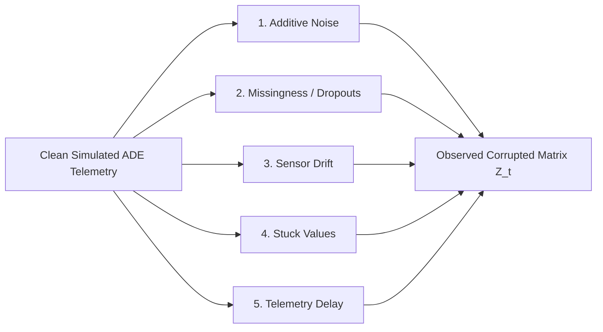
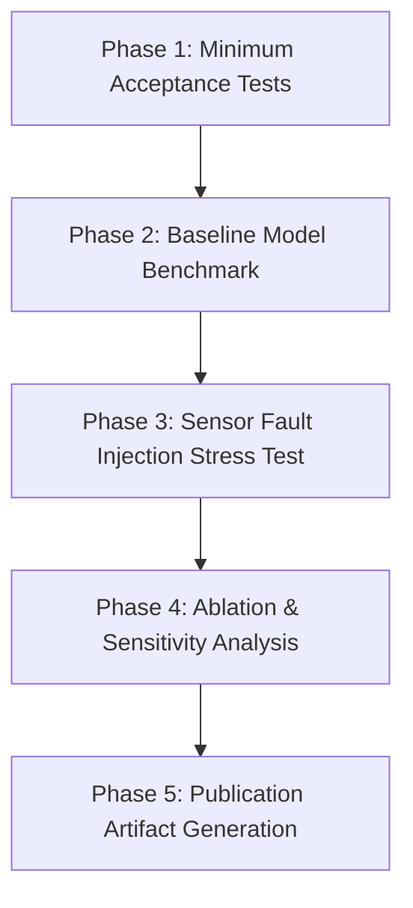

# Research Experiment Plan: Uncertainty-Aware Source Attribution under Sensor Faults with Explicit Abstention

**Project:** Smart Tiruppur Environmental Digital Twin / NoyyalSense
**Document Type:** Formal Research Experiment Plan & Protocol
**Target Manuscript:** Environmental Modelling & Software / IEEE Transactions on AgriFood & Environmental Informatics
**Last Updated:** October 2026
**Status:** Audit & Experiment Planning Protocol (Pre-Implementation Baseline)

---

## 1. Executive Summary & Audit Context

This document establishes the experimental methodology for evaluating **uncertainty-aware pollution-source attribution with an explicit abstain option under sensor faults** in the Noyyal River industrial corridor (Tiruppur, Tamil Nadu).

A comprehensive architectural and source-code audit of the Smart Tiruppur / NoyyalSense repository was performed to distinguish genuinely implemented capabilities from planned features and mock placeholders. The results of that audit directly inform the experimental protocols defined below.

---

## 2. Source-Grounded Repository Capability Audit

| Research Capability | Implementation Status in Repo | Primary Source File(s) | Genuine Functionality & Architectural Boundaries |
| :--- | :---: | :--- | :--- |
| **Source-Attribution Algorithm** | **Partial (Heuristic Screening)** | [`lib/attribution/engine.ts`](file:///c:/Users/S.Thisha/Downloads/smart-tiruppur/lib/attribution/engine.ts)<br>[`lib/digital-twin/sensors.ts`](file:///c:/Users/S.Thisha/Downloads/smart-tiruppur/lib/digital-twin/sensors.ts)<br>[`lib/adapter.ts`](file:///c:/Users/S.Thisha/Downloads/smart-tiruppur/lib/adapter.ts) | • `rankUpstreamSources()` computes a weighted heuristic score: $\text{score} = 0.45 \cdot \text{distance} + 0.25 \cdot \text{timing} + 0.30 \cdot \text{load}$.<br>• Distance uses straight-line Euclidean distance between snapped river points (`downstreamDistance()` is a zero-return stub).<br>• Nominal river velocity is fixed at $0.25\text{ m/s}$.<br>• `buildSensorLayer()` renders visual exponential attenuation ($D_0 = 0.25 L_{\text{river}}$), explicitly labeled as a visual overlay.<br>• `adaptHariEvent()` in `lib/adapter.ts` parses external API responses from a remote service, but no physical transport inversion runs locally. |
| **Confidence / Uncertainty Estimation** | **Missing (Static Placeholders)** | [`lib/attribution/engine.ts`](file:///c:/Users/S.Thisha/Downloads/smart-tiruppur/lib/attribution/engine.ts)<br>[`lib/digital-twin/industrial.ts`](file:///c:/Users/S.Thisha/Downloads/smart-tiruppur/lib/digital-twin/industrial.ts) | • In `lib/attribution/engine.ts`, `confidence` is hardcoded to a static scalar `0.35` across all units.<br>• Velocity uncertainty is documented solely as a string caveat (`FLOW_VELOCITY_UNCERTAINTY = "±50%; uncalibrated model parameter"`).<br>• In `lib/adapter.ts`, `evidenceSufficiency` uses hardcoded threshold comparisons (`confidence < 0.55 || gap < 0.15 || missingCount > 1`).<br>• No Bayesian posterior, ensemble variance, conformal prediction interval, or calibration framework exists in local code. |
| **Explicit Abstain Decision** | **Missing in Local Engines** | [`lib/adapter.ts`](file:///c:/Users/S.Thisha/Downloads/smart-tiruppur/lib/adapter.ts)<br>[`lib/types.ts`](file:///c:/Users/S.Thisha/Downloads/smart-tiruppur/lib/types.ts) | • Production `rankUpstreamSources()` always ranks all 12 candidate units; it lacks an abstention mechanism or rejection threshold.<br>• `adaptHariEvent()` accepts a normalized `"abstain"` decision received from an external remote service, but the local engine cannot generate or evaluate abstentions.<br>• Existing evaluation scripts in `research/evaluation/` force binary classification decisions. |
| **Sensor Fault Simulation** | **Partial (Missingness & Outages Only)** | [`research/evaluation/robustness/robustness_test.py`](file:///c:/Users/S.Thisha/Downloads/smart-tiruppur/research/evaluation/robustness/robustness_test.py) | • Implements random feature masking (10%, 25%, 50%) and station-wide outage masking (20%, 40%, 60%) using `numpy.random`.<br>• **Missing:** Additive noise models, sensor drift (ramp/bias), stuck-value (frozen sensor) detection, and telemetry delay simulation are not implemented. |
| **Ground-Truth Source Labels** | **Missing** | [`research/evaluation/evaluator.py`](file:///c:/Users/S.Thisha/Downloads/smart-tiruppur/research/evaluation/evaluator.py)<br>[`research/data/README.md`](file:///c:/Users/S.Thisha/Downloads/smart-tiruppur/research/data/README.md) | • Ground-truth labels in `evaluator.py` represent single-station water quality threshold exceedances ($\text{pH} \notin [6.5, 8.5]$, $\text{BOD} > 3$, etc.), **not** source attribution.<br>• No facility spill ground-truth labels exist. Historical station file `research/data/noyyal_observations.csv` is absent from the repo (scripts abort if run). Existing JSON results reflect prior static runs. |
| **Audit Ledger & Tamper Verification** | **Missing (Remote Reference Only)** | [`lib/config.ts`](file:///c:/Users/S.Thisha/Downloads/smart-tiruppur/lib/config.ts)<br>[`lib/types.ts`](file:///c:/Users/S.Thisha/Downloads/smart-tiruppur/lib/types.ts)<br>[`app/verify/page.tsx`](file:///c:/Users/S.Thisha/Downloads/smart-tiruppur/app/verify/page.tsx)<br>[`lib/actions/engine.ts`](file:///c:/Users/S.Thisha/Downloads/smart-tiruppur/lib/actions/engine.ts) | • `LEDGER_BASE_URL` points to an external microservice.<br>• `lib/types.ts` defines `LedgerEntry` interface fields (`previous_hash`, `current_hash`).<br>• `app/verify/page.tsx` queries the external URL; `lib/actions/engine.ts` uses static UI labels (`"SHA-256 Tamper-Evident Ledger Verified"`).<br>• **No local cryptographic hash-chain, block verification, or Merkle tree code exists in the repository.** Per task requirements, ledger evaluation is documented as future implementation work. |
| **Automated Evaluation Scripts** | **Implemented for Water-Quality Baselines** | [`research/evaluation/`](file:///c:/Users/S.Thisha/Downloads/smart-tiruppur/research/evaluation/) | • `evaluator.py`, `baseline_eval.py`, `ablation_study.py`, and `robustness_test.py` execute cross-validated Random Forest and STERI index evaluations.<br>• All existing scripts evaluate generic water-quality exceedance, **not** multi-class industrial source attribution or selective abstention under sensor faults. |
| **Unit Tests & Test Runners** | **Missing** | [`package.json`](file:///c:/Users/S.Thisha/Downloads/smart-tiruppur/package.json) | • No test framework (Jest, Vitest, pytest) is configured in `package.json` or root configs.<br>• Only manual UI test protocols (`docs/research/validation-matrix.md`) and static build checks (`npx tsc`, `npm run build`) currently exist. |

---

## 3. Research Questions & Falsifiable Hypotheses

### 3.1 Primary Research Question
*Can uncertainty-aware selective classification with an explicit abstain option reduce erroneous industrial accusations in an uncalibrated river telemetry network under sensor hardware and communication faults (noise, drift, stuck values, dropouts, and latency), without requiring fine-grained hydrodynamic cross-sections?*

### 3.2 Falsifiable Hypotheses

> **Methodological Qualification:** The numerical performance thresholds stated below ($\ge 70\%$ coverage, $\ge 35\%$ relative error reduction, $\le 12\%$ accepted error) are **provisional benchmarking targets** designed to evaluate directional improvement under the proposed formulation. They are not claimed as pre-existing empirical findings or values justified by formal statistical power analysis.

* **Hypothesis 1 (Selective Error Reduction Target):**
  Under non-faulted baseline conditions, selective attribution operating at a provisional coverage target of $\ge 70\%$ reduces the error rate on accepted decisions relative to a standard forced-choice multi-class classifier ($\mathcal{R}_{\text{selective}} \le 0.65 \times \mathcal{R}_{\text{forced}}$).
* **Hypothesis 2 (Fault Robustness via Abstention Target):**
  Under progressive sensor fault injection (sensor drift $\beta \ge 1.5\sigma/\text{hr}$, frozen sensor outputs, or burst dropouts $\ge 25\%$), the proposed model shifts affected predictions into the **`ABSTAIN`** category, maintaining the error rate on accepted attributions within a target bound ($\le 12\%$), whereas unselective baselines degrade monotonically under corrupted observations.
* **Hypothesis 3 (Fault Detection & Error Containment):**
  Under severe sensor corruptions (drift, stuck values, dropouts, and latency), incorporating dedicated sensor-fault diagnostics (CUSUM drift checks, zero-variance stuck-sensor tests, and timestamp freshness checks) allows the model to identify telemetry corruption and trigger informed abstentions, thereby reducing selective attribution error compared to confidence-only models that accept corrupted readings. The trade-off between coverage, selective error, and fault identification will be empirically characterized rather than assuming an a priori coverage increase.

---

## 4. Problem Formulation & Decision Space

### 4.1 System Definitions
Let $\mathcal{S} = \{s_1, s_2, \dots, s_K\}$ denote the set of $K = 12$ candidate industrial dyeing and processing facilities mapped in the Tiruppur urban corridor ([`lib/digital-twin/industrial.ts`](file:///c:/Users/S.Thisha/Downloads/smart-tiruppur/lib/digital-twin/industrial.ts)), plus an explicit null/background class $s_0$ representing non-point agricultural runoff, municipal discharge, or baseline river variations:
$$\mathcal{S}^+ = \{s_0, s_1, s_2, \dots, s_{12}\}$$

Let $\mathcal{M} = \{m_1, m_2, m_3\}$ denote the 3 telemetry monitoring stations positioned along the main stem of the Noyyal River ([`lib/digital-twin/sensors.ts`](file:///c:/Users/S.Thisha/Downloads/smart-tiruppur/lib/digital-twin/sensors.ts)):
1. $m_1$: **Mangalam Telemetry Station** (`sensor_001`, Upstream baseline, Chainage $x_1 = 0.0\text{ km}$).
2. $m_2$: **Kasipalayam Bridge Telemetry** (`sensor_002`, Urban/Industrial exit, Chainage $x_2 = 14.8\text{ km}$).
3. $m_3$: **Orathapalayam Reservoir Exit** (`sensor_003`, Downstream containment, Chainage $x_3 = 31.2\text{ km}$).

At each evaluation time-step $t$, the system observes a multi-sensor telemetry matrix $\mathbf{Z}_t \in \mathbb{R}^{3 \times P}$ spanning measured parameters:
$$P = \{\text{pH}, \text{EC}\ (\mu\text{S/cm}), \text{Turbidity}\ (\text{NTU}), Q\ (\text{Streamflow}, \text{m}^3/\text{s})\}$$
along with a diagnostic sensor health status vector $\mathbf{h}_t \in \{0, 1\}^3$.

### 4.2 Decision Rule & Abstain Specification
A source-attribution decision is a function $f: (\mathbf{Z}_t, \mathbf{h}_t) \to (D_t, \hat{s}_t, \hat{c}_t, \mathcal{R}_t)$ where:

1. **Attribution Decision ($D_t = \text{ATTRIBUTE}$):**
   * $\hat{s}_t \in \mathcal{S}^+$ is the identified source facility.
   * $\hat{c}_t \in [0, 1]$ is the calibrated posterior confidence: $\hat{c}_t = P(y = \hat{s}_t \mid \mathbf{Z}_t)$.
   * **Acceptance Criteria:** The decision is accepted if and only if all three gating conditions hold:
     $$\hat{c}_t \ge \tau_{\text{conf}} \quad \text{AND} \quad \left(P_{(1)} - P_{(2)}\right) \ge \delta_{\text{margin}} \quad \text{AND} \quad \mathbf{h}_t \text{ passes health validation}$$
     where $P_{(1)}$ and $P_{(2)}$ are the top two candidate class probabilities.

2. **Abstain Outcome ($D_t = \text{ABSTAIN}$):**
   * $\hat{s}_t = \emptyset$ (no specific industrial facility is accused).
   * An explicit diagnostic cause code $\mathcal{R}_t$ is emitted:
     $$\mathcal{R}_t \in \{\text{LOW\_CONFIDENCE}, \text{AMBIGUOUS\_MARGIN}, \text{SENSOR\_FAULT\_DRIFT}, \text{SENSOR\_FAULT\_STUCK}, \text{SENSOR\_FAULT\_MISSING}, \text{EXCESSIVE\_LATENCY}, \text{UNMODELED\_CORRIDOR}\}$$
   * **Operational Implication:** Triggers an advisory dispatch to verify field sensors or take manual grab samples; explicitly protects facilities from automated regulatory penalties during periods of data ambiguity.

---

## 5. Controlled River Simulation & Ground-Truth Generation

### 5.1 Physical System Context & Hydrology Model Selection

> **Critical Hydrological Distinction:**
> The simulation domain implemented in this benchmark is an **idealized synthetic 1D screening channel** parameterized with nominal longitudinal scales inspired by the Tiruppur urban corridor. It is **not** a calibrated hydrodynamic model of the actual Noyyal River. The real Noyyal River exhibits complex tropical seasonal dynamics, wide dry sand beds, braided low flows, ungauged ephemeral runoff tributaries, check dams, and uncharacterized weir structures whose bathymetry and rating curves are absent from open public datasets.
>
> Furthermore, pressurized pipe network models (such as **EPANET**) are physically invalid for open-channel fluvial systems. Full 2D hydrodynamic models (e.g., HEC-RAS 2D, MIKE 21) would require field-surveyed cross-sections that cannot be fabricated.
>
> To maintain scientific integrity, this research employs a **simplified 1D advection–dispersion screening model (ADE)** with lateral point-source tracer injections. This provides a mathematically transparent, mass-conservative benchmark for evaluating source attribution and sensor fault abstention under controlled conditions.

### 5.2 1D Advection–Dispersion Transport Formulation & Assumptions

Tracer concentration $C(x, t)$ along river chainage $x \in [0, L]$ is governed by the 1D advection–dispersion equation:
$$\frac{\partial C}{\partial t} + u \frac{\partial C}{\partial x} = D_L \frac{\partial^2 C}{\partial x^2} - k_{\text{decay}} C + \sum_{k=1}^K \frac{\dot{M}_k(t)}{A} \delta(x - x_k)$$

Where:
* $C(x, t)$: Transported tracer mass concentration in $\text{g/m}^3$ (equivalent to $\text{mg/L}$). Non-negative physical state: $C(x, t) \ge 0.0\text{ g/m}^3$.
* $u$: Cross-sectionally averaged longitudinal velocity ($0.25\text{ m/s}$ baseline, matching `DEFAULT_FLOW_VELOCITY_MPS` in [`lib/attribution/engine.ts`](file:///c:/Users/S.Thisha/Downloads/smart-tiruppur/lib/attribution/engine.ts)).
* $D_L$: Effective longitudinal dispersion coefficient ($4.5\text{ m}^2/\text{s}$ baseline).
  * **Theoretical Note on Taylor–Elder Dispersion:** Elder (1959) derived $D_L = 5.93 \cdot d \cdot u_*$ under the strict assumptions of an infinitely wide, uniform open channel with a purely vertical logarithmic velocity profile and no lateral velocity shear. In natural rivers, lateral velocity shear across the channel width and transient storage zones typically dominate longitudinal spreading, often yielding dispersion coefficients an order of magnitude higher ($D_L \sim 10 - 50\text{ m}^2/\text{s}$). Consequently, $D_L$ is treated here as an **effective screening parameter** and subjected to broad sensitivity sweeps rather than claimed as an exact physical representation.
* $k_{\text{decay}}$: First-order decay rate in $\text{s}^{-1}$. Conversions: $k_{\text{decay, s}} = k_{\text{decay, h}} / 3600$. Baseline is $0.0\text{ s}^{-1}$ for conservative tracer; nominal sensitivity range is $[0, 0.05]\text{ h}^{-1}$ ($[0, 1.39 \times 10^{-5}]\text{ s}^{-1}$). Extreme sink stress testing is evaluated separately.
* $A$: Nominal cross-sectional flow area ($25.0\text{ m}^2$).
* $\dot{M}_k(t)$: Tracer mass injection rate ($\text{g/s}$) from candidate source $k$ at chainage $x_k$.

### 5.3 Synthetic Parameters and Sensitivity Analysis Grid

All physical parameters in the simulator are explicitly documented as **synthetic modeling assumptions**. Their baseline values and sensitivity ranges are defined as follows:

| Simulation Parameter | Synthetic Baseline | Sensitivity Sweep Range | Physical / Modeling Rationale |
| :--- | :---: | :---: | :--- |
| **Domain Length ($L$)** | $32,000\text{ m}$ ($32\text{ km}$) | Fixed | Nominal span covering upstream entry to downstream reservoir exit. |
| **Cross-Section Area ($A$)** | $25.0\text{ m}^2$ | $[15.0, 40.0]\text{ m}^2$ | Nominal urban channel geometry ($w \approx 25\text{ m}, d \approx 1\text{ m}$). |
| **Effective Velocity ($u$)** | $0.25\text{ m/s}$ | $[0.125, 0.375]\text{ m/s}$ | $\pm 50\%$ uncalibrated velocity uncertainty documented in `lib/attribution/engine.ts`. |
| **Longitudinal Dispersion ($D_L$)** | $4.5\text{ m}^2/\text{s}$ | $[1.5, 15.0]\text{ m}^2/\text{s}$ | Spans Elder's baseline to shear-augmented open-channel dispersion. |
| **First-Order Decay ($k_{\text{decay}}$)** | $0.0\text{ h}^{-1}$ ($0.0\text{ s}^{-1}$) | $[0.0, 0.05]\text{ h}^{-1}$ ($[0.0, 1.39 \times 10^{-5}]\text{ s}^{-1}$) | Nominal sensitivity range for conservative vs. decaying contaminant. Stress tests evaluate higher rates separately. |
| **Background Tracer ($C_{\text{tracer,base}}$)** | $0.0\text{ g/m}^3$ | $[0.0, 5.0]\text{ g/m}^3$ | Ambient background of specific industrial dye tracer. |
| **Decoupled Baseline EC ($EC_{\text{base}}$)** | $50.0\ \mu\text{S/cm}$ | $[20.0, 100.0]\ \mu\text{S/cm}$ | Illustrative ambient conductivity indicator. Not converted to tracer concentration without site empirical calibration. |
| **Spill Duration ($\Delta t_{\text{spill}}$)** | $1.0 - 3.0\text{ h}$ | $[0.5, 6.0]\text{ h}$ | Typical batch wash/dye discharge cycle duration. |
| **Tracer Mass Injected ($M_{\text{inj}}$)** | $50 - 500\text{ kg}$ | $[10, 1000]\text{ kg}$ | Scale calibrated to produce detectable concentration peaks downstream. |

### 5.4 Ground-Truth Event Generation & Observability Limitations

The benchmark generates controlled episodes with known source labels:
1. **Source Classes:** $K = 12$ candidate industrial facilities positioned at synthetic channel chainages $x_1 \dots x_{12} \in [2.5\text{ km}, 28.0\text{ km}]$ corresponding to `unit_001`–`unit_012` ([`lib/digital-twin/industrial.ts`](file:///c:/Users/S.Thisha/Downloads/smart-tiruppur/lib/digital-twin/industrial.ts)), plus a negative baseline class $s_0$ (clean flow / non-point background).
2. **Monitoring Stations:** $M = 3$ monitoring stations positioned at chainages $x = 0.0\text{ km}$ ($m_1$, Mangalam), $x = 14.8\text{ km}$ ($m_2$, Kasipalayam), and $x = 31.2\text{ km}$ ($m_3$, Orathapalayam).
3. **Observability Limitations:**
   > **Fundamental Limitation:** Attempting to uniquely localize 12 candidate discharge points using only 3 downstream sensor stations poses an **ill-posed inverse problem**. Multiple sources located between the same upstream and downstream sensor stations produce overlapping plume arrival shapes that may be mathematically indistinguishable under sensor noise and dispersion. This fundamental physical limit directly motivates the **explicit abstain option**: when data cannot uniquely distinguish candidate sources, the model must abstain rather than produce a high-confidence false accusation.

---

## 6. Sensor Fault Injection Design

To rigorously evaluate the explicit abstain capability, the experiment injects five distinct, realistic sensor degradation modes:



1. **Additive Measurement Noise ($\mathcal{F}_{\text{noise}}$):**
   $$z_{m, p}'(t) = z_{m, p}(t) + \epsilon, \quad \epsilon \sim \mathcal{N}(0, \sigma_p^2)$$
   where $\sigma_p \in \{0.05, 0.15, 0.25\} \times \text{std}(z_{m, p})$ models electrochemical sensor noise.
2. **Missing Readings & Burst Dropouts ($\mathcal{F}_{\text{missing}}$):**
   * *Random Dropouts:* Independent Bernoulli missingness with rate $p_{\text{miss}} \in \{0.10, 0.25, 0.50\}$.
   * *Burst Outages:* Consecutive data loss spanning $\Delta t_{\text{burst}} \in [1, 8]\text{ hours}$ on 1 or 2 stations, simulating power loss or mobile cellular disconnects.
3. **Calibration Drift ($\mathcal{F}_{\text{drift}}$):**
   Linear ramp drift simulating optical turbidity biofouling or reference electrode leakage:
   $$z_{m, p}'(t) = z_{m, p}(t) + \beta \cdot (t - t_{\text{fault}}), \quad t \ge t_{\text{fault}}$$
   where drift rate $\beta \in [0.02, 0.10] \times \text{std}(z_{m, p})/\text{hour}$.
4. **Stuck-Value / Sensor Freezing ($\mathcal{F}_{\text{stuck}}$):**
   The sensor repeatedly reports a constant value $z_{m, p}'(t) = z_{m, p}(t_{\text{fault}})$ for all $t \ge t_{\text{fault}}$, despite varying instream chemical concentrations (simulating ADC register freeze or software thread hang).
5. **Telemetry Latency / Asynchronous Delay ($\mathcal{F}_{\text{delay}}$):**
   Station telemetry packets arrive out-of-order or delayed by $\Delta t_{\text{delay}} \in [1, 6]\text{ hours}$, violating advective synchronization assumptions.

---

## 7. Comparative Methodologies

The benchmark compares four distinct architectures, explicitly separating the task of **anomaly detection** from the task of **source attribution / localization**:

| Method ID | Method Name | Architecture & Operational Role | Uncertainty Mechanism | Attribution & Abstention Capability |
| :--- | :--- | :--- | :---: | :---: |
| **M1** | **Threshold Alarm Detector + Heuristic Attribution** | **Two-stage decoupled baseline:** Stage 1 performs rule-based anomaly detection when Kasipalayam ($m_2$) exceeds $\text{EC} > 2500\ \mu\text{S/cm}$ or $\text{pH} \notin [6.5, 8.5]$. A threshold alarm alone cannot identify a source; Stage 2 therefore uses an ad-hoc heuristic blaming the largest upstream nominal emitter. | None | **None** (Alarms whenever threshold is breached; attributes to highest-volume unit without reject option) |
| **M2** | **Nearest-Sensor Heuristic Attributor** | Spatial advective proximity engine matching current [`lib/attribution/engine.ts`](file:///c:/Users/S.Thisha/Downloads/smart-tiruppur/lib/attribution/engine.ts). Ranks candidate sources based on snapped Euclidean distance and advective travel time. | None (Hardcoded scalar 0.35) | **None** (Always ranks and outputs all 12 candidate facilities) |
| **M3** | **Standard Multi-Class Classifier** | Supervised Random Forest / Gradient Boosted Trees trained on multi-sensor temporal features. Directly outputs $\hat{s}_t = \arg\max_{k} P(s_k \mid \mathbf{Z}_t)$. | Raw softmax / tree vote fraction | **None (Forced Choice)** (Forced to output a facility label for every detected event) |
| **M4 (Proposed)** | **Selective Attribution with Fault-Gated Abstention** | Dual-stage integrated framework: (1) Hardware diagnostics (CUSUM drift, zero-variance stuck checks, latency checks) identify sensor corruption; (2) Temperature-calibrated posterior probabilities evaluate confidence $\tau_{\text{conf}}$ and margin $\delta_{\text{margin}}$ before accepting an attribution. | Temperature-calibrated posteriors + Sensor health diagnostics | **Explicit Abstention** (Emits `ABSTAIN` with diagnostic cause code $\mathcal{R}_t$; accepts attribution only when evidence is conclusive) |

---

## 8. Evaluation Metrics (Decoupled by Task)

To evaluate system performance rigorously, the metrics are partitioned into two distinct evaluation tasks:

### 8.1 Task 1: Anomaly Detection Performance
Evaluates how accurately the system identifies that a contamination event is occurring in the river, regardless of which source caused it:

1. **Detection Rate ($\text{DR}$, Sensitivity / Recall):**
   $$\text{DR} = \frac{\text{True Contamination Episodes Detected}}{\text{Total Ground-Truth Contamination Episodes}}$$
2. **False Alarm Rate ($\text{FAR}$, Fall-out):**
   $$\text{FAR} = \frac{\text{Alarms Triggered During Clean Background Flow}}{\text{Total Clean Evaluation Windows}}$$
3. **Time-to-Detect ($\text{TTD}$):**
   Mean elapsed time (hours) from contaminant discharge onset to the first alarm or accepted detection at downstream sensors.

### 8.2 Task 2: Source Attribution & Selective Classification Performance
Evaluates how accurately the system attributes a detected contamination event to the true emitting industrial facility, and how safely it abstains:

1. **Overall Attribution Accuracy ($\text{Acc}_{\text{overall}}$, Forced-Choice):**
   $$\text{Acc}_{\text{overall}} = \frac{1}{N} \sum_{i=1}^N \mathbb{I}(\hat{s}_i = y_i)$$
   Measures accuracy if the model were forced to guess on every episode ($D_i = \text{ATTRIBUTE}$ for all $i$).
2. **Coverage ($\Phi$, Acceptance Rate):**
   $$\Phi = \frac{|\{i : D_i = \text{ATTRIBUTE}\}|}{N}$$
   The fraction of evaluation episodes on which the model accepts an attribution decision rather than abstaining.
3. **Selective Risk / Error on Accepted Predictions ($\mathcal{R}(\Phi)$):**
   $$\mathcal{R}(\Phi) = \frac{\sum_{i : D_i = \text{ATTRIBUTE}} \mathbb{I}(\hat{s}_i \neq y_i)}{|\{i : D_i = \text{ATTRIBUTE}\}|}$$
   The fraction of false accusations among decisions the model actually accepted.
4. **Risk–Coverage Trade-Off Curve:**
   Plot of $\mathcal{R}(\Phi)$ as a function of coverage $\Phi \in [0.10, 1.00]$, generated by sweeping confidence threshold $\tau_{\text{conf}}$.
5. **Abstention Appropriateness Rate ($\text{AAR}$):**
   Fraction of abstain decisions that were genuinely justified by severe sensor faults ($\mathcal{F}_{\text{drift}}, \mathcal{F}_{\text{stuck}}, \mathcal{F}_{\text{missing}} \ge 25\%$) or unidentifiable overlapping plumes:
   $$\text{AAR} = \frac{\sum_{i : D_i = \text{ABSTAIN}} \mathbb{I}(\text{Fault Present}_i \lor \text{Plume Ambiguous}_i)}{|\{i : D_i = \text{ABSTAIN}\}|}$$

---

## 9. Ablation Study Design

To isolate the contribution of each algorithmic component in the proposed method (M4), four ablation variants are evaluated under identical fault-injection conditions:

| Ablation ID | Model Configuration | Description & Scientific Purpose |
| :--- | :--- | :--- |
| **ABL-1** | **Full Proposed Model** | Calibrated probabilities + Margin threshold $\delta_{\text{margin}}$ + Sensor health fault gate (CUSUM, zero-variance, freshness). |
| **ABL-2** | **w/o Sensor Fault Checks** | Removes hardware diagnostic filters. The model abstains solely based on low classification confidence ($\hat{c}_t < \tau_{\text{conf}}$). Evaluates whether statistical confidence alone detects hardware drift and stuck sensors. |
| **ABL-3** | **w/o Probability Calibration** | Uses uncalibrated raw softmax scores for thresholding without temperature scaling or Platt scaling. Evaluates the impact of miscalibration on selective risk. |
| **ABL-4** | **w/o Margin Gap Check** | Sets $\delta_{\text{margin}} = 0$, evaluating confidence $\tau_{\text{conf}}$ only. Measures false attributions occurring when two top candidates are tied (e.g., $P_{(1)} = 0.51, P_{(2)} = 0.49$). |
| **ABL-5** | **Forced-Choice (No Abstention)** | Sets $\tau_{\text{conf}} = 0, \delta_{\text{margin}} = 0$, forcing an attribution on all events ($\Phi = 1.0$). Reverts to conventional unselective classification. |

---

## 10. Experimental Splits, Statistical Rigor & Sensitivity Protocol

### 10.1 Data Partitioning & Independence
* **Total Simulated Episodes:** $N = 2,400$ independent discharge and background episodes.
* **Train Set (60%, $n = 1,440$):** Used strictly for model training under clean and baseline noise conditions.
* **Calibration & Tuning Set (20%, $n = 480$):** Used for temperature scaling optimization, threshold tuning ($\tau_{\text{conf}}, \delta_{\text{margin}}$), and CUSUM drift calibration.
* **Held-Out Test Set (20%, $n = 480$):** Evaluated strictly once per experiment under full fault-injection suites.
* **Spatial Stratification:** Ensures episodes from all 12 industrial locations (upstream Mangalam cluster, central urban cluster, and downstream corridor) are balanced across splits.

### 10.2 Independent Random Seeds & Statistical Confidence
* All experiments are repeated across **10 independent random seeds**:
  `SEEDS = [42, 101, 202, 303, 404, 505, 606, 707, 808, 909]`
* All reported metrics ($\text{Acc}, \mathcal{R}(\Phi), \Phi, \text{TTD}$) must report the mean and **95% bootstrap confidence intervals** computed over 1,000 resamples.

### 10.3 Parameter Sensitivity Sweep
To satisfy scientific integrity regarding uncalibrated environmental parameters:
* **River Velocity Sensitivity:** Sweep $u \in [0.125, 0.187, 0.250, 0.312, 0.375]\text{ m/s}$ ($\pm 50\%$ around baseline $0.25\text{ m/s}$).
* **Dispersion Coefficient Sensitivity:** Sweep $D_L \in [2.0, 4.5, 9.0, 15.0]\text{ m}^2/\text{s}$.
* **Background Flow Variability:** Vary baseflow $Q_{\text{base}} \in [5, 10, 25]\text{ m}^3/\text{s}$.

---

## 11. Audit Ledger Integrity Evaluation (Future Implementation Specification)

### 11.1 Audit Finding
As established in Section 2, **no local cryptographic ledger, Merkle tree, or tamper-verification code exists in the repository**. Existing files only reference remote URLs ([`lib/config.ts`](file:///c:/Users/S.Thisha/Downloads/smart-tiruppur/lib/config.ts)) and UI mock labels.

### 11.2 Future Ledger Threat Model & Verification Protocol
When a local tamper-evident decision ledger is implemented, it must be evaluated under the following dedicated threat model:

1. **Threat Model Capabilities:**
   * *Retroactive History Modification:* Adversary attempts to alter a logged attribution decision ($s_k \to \text{ABSTAIN}$ or $s_k \to s_j$) to shield a non-compliant facility.
   * *Log Truncation & Block Omission:* Adversary deletes historical penalty entries or suppresses high-severity alerts.
   * *State Injection:* Adversary inserts backdated sensor events without valid telemetry cryptographic signatures.
2. **Evaluation Metrics for Future Ledger Module:**
   * *Tamper Detection Recall:* $100\%$ detection of single-bit payload modifications via SHA-256 hash-chain verification:
     $$H_i = \text{SHA-256}(H_{i-1} \parallel \text{Timestamp} \parallel \text{EventPayload} \parallel \text{Decision})$$
   * *Audit Verification Latency:* Time required to verify a complete ledger chain of $10,000$ entries ($< 500\text{ ms}$).
   * *Storage Overhead:* Incremental bytes per attribution decision record ($\le 256\text{ bytes/record}$).

---

## 12. Implementation Architecture & Execution Roadmap

### 12.1 Recommended Standalone Directory Structure
To strictly preserve production web application code ([`app/`](file:///c:/Users/S.Thisha/Downloads/smart-tiruppur/app/), [`lib/`](file:///c:/Users/S.Thisha/Downloads/smart-tiruppur/lib/)), all research experiment code must reside in a dedicated, isolated research tree:

```text
smart-tiruppur/
├── research/
│   ├── configs/
│   │   ├── simulation_params.json     # ADE physical constants (u=0.25, D_L=4.5)
│   │   ├── fault_injection.json       # Noise, drift, stuck, and dropout rates
│   │   └── experiment_grid.json       # Seeds, threshold grids, split definitions
│   ├── simulation/
│   │   ├── __init__.py
│   │   ├── river_ade_simulator.py     # 1D Taylor-Elder advection-dispersion engine
│   │   └── synthetic_event_generator.py # Controlled industrial spill episodes
│   ├── models/
│   │   ├── __init__.py
│   │   ├── baselines.py               # M1 (Threshold), M2 (Nearest), M3 (RandomForest)
│   │   ├── selective_attributor.py    # M4 Proposed (Calibrated ensemble + fault gate)
│   │   └── sensor_diagnostics.py      # CUSUM drift, zero-variance, and latency checkers
│   ├── experiments/
│   │   ├── exp1_baseline_comparison.py # Comparative evaluation (M1 vs M2 vs M3 vs M4)
│   │   ├── exp2_fault_robustness.py    # Progressive fault-injection stress testing
│   │   ├── exp3_ablation_study.py      # Ablation study (ABL-1 through ABL-5)
│   │   └── exp4_velocity_sensitivity.py # River flow velocity uncertainty (±50%)
│   └── results/
│       ├── raw_predictions/           # Saved JSON/CSV predictions per seed
│       ├── summary_tables/            # LaTeX and Markdown result tables
│       └── figures/                   # Risk-coverage curves and drift diagnostic plots
```

### 12.2 Phased Execution Plan & Minimum Acceptance Tests



#### Step 1: Minimum Acceptance Tests (Run Prior to Full Experiment)
Before initiating large-scale evaluations, the implementation must pass four automated unit verification tests:
1. **ADE Mass Conservation Test:** Independently reconstruct mass balance from raw injection schedules, spatial grid concentration profiles, and exported boundary flux histories, verifying that numerical residual is bounded by discrete finite-volume precision ($< 10^{-10}$ relative residual).
2. **Spatial Topology Consistency Test:** Ensure that snapped facility coordinates match the river chainage order defined in `lib/digital-twin/industrial.ts` and `lib/digital-twin/sensors.ts`.
3. **Fault Injector Determinism Test:** Ensure that fault injection with a fixed seed produces bitwise-identical corrupted matrices.
4. **Abstention Gate Sanity Test:** Confirm that when an input matrix has zero variance across all sensors (frozen state), M4 emits `ABSTAIN` with cause code `SENSOR_FAULT_STUCK` 100% of the time.

#### Step 2: Sequence of Empirical Experiments
1. **Experiment 1 (Clean Baseline Comparison):** Compare M1, M2, M3, M4 on uncorrupted held-out test data. Evaluate Hypothesis 1 (Selective Error Reduction).
2. **Experiment 2 (Fault Robustness Stress Test):** Evaluate M1–M4 across the five fault modes (noise, missing, drift, stuck, delay). Evaluate Hypothesis 2 and 3.
3. **Experiment 3 (Ablation Analysis):** Execute ABL-1 through ABL-5 under moderate fault conditions ($\beta = 0.05\sigma/\text{hr}$, $25\%$ missingness).
4. **Experiment 4 (Hydraulic Velocity Sensitivity):** Sweep velocity $u \in [0.125, 0.375]\text{ m/s}$ to quantify performance resilience under uncalibrated river velocity assumptions.

---

## 13. Scientific Data Provenance & Reproducibility Statement

1. **Zero Data Fabrication Policy:**
   This study explicitly documents that empirical facility-by-facility discharge volumes and chemical spill incident logs for the Noyyal River are not present in public government records. Consequently, all source attribution evaluations are conducted in a **controlled synthetic screening environment**, and results will be reported strictly as synthetic model benchmarks rather than historical ground-truth field claims.
2. **Hardware & Environment Specification:**
   Experiments are designed to execute reproducibly on standard workstations (Python 3.10+, `numpy>=1.24`, `scipy>=1.10`, `scikit-learn>=1.3`, `pandas>=2.0`) without requiring proprietary GPU clusters or specialized hydraulic simulation licenses.
3. **Artifact Availability:**
   All random seeds, parameter configuration JSONs, generated simulation traces, raw prediction outputs, and plotting scripts will be preserved in `research/` to enable exact end-to-end auditability and reproduction.
