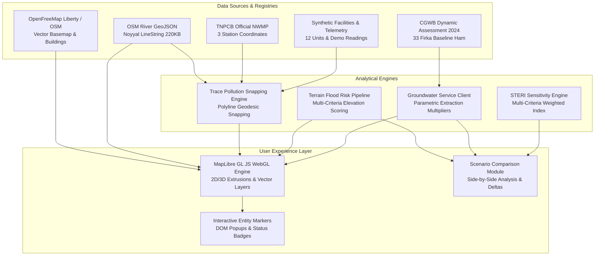

# Research Figure Captions and Publication Plans: Smart Tiruppur / NoyyalSense

**Project:** Smart Tiruppur Environmental Digital Twin / NoyyalSense  
**Document Type:** Scientific Figure Specifications & Publication Captions  
**Target Audience:** Academic Journal Authors, Reviewers, Geospatial Editors  
**Last Updated:** October 2026  
**Standards:** Publication guidelines for environmental informatics and GIScience manuscripts  

---

## 1. Figure Capture and Export Workflow

To ensure scientific integrity and visual consistency, all figures should be captured using the existing system capabilities described below. **No figures or statistical outcomes should be fabricated.**

### 1.1 Capturing Figures from `/terrain-map-prototype`
* **Technology:** MapLibre GL JS vector canvas with HTML DOM interactive overlays (markers, popups, and side-panel inspection cards).
* **Recommended Capture Method:** Full-viewport high-resolution browser capture (e.g., standard browser Developer Tools device screenshot at $2\times$ pixel ratio or $2560 \times 1440$ resolution).
* **Requirements:**
  1. Set the exact camera presets specified for each figure.
  2. Enable the required layer toggles and select target entities.
  3. Ensure the bottom-right Legend box and top-right Provenance / Attribution badges are unobstructed.

### 1.2 Capturing Figures from `/terrain` (Three.js 3D Viewer)
* **Technology:** Three.js WebGL canvas with custom 2D canvas figure compositing.
* **Built-in Export Feature:** Click the **`Figure`** button in the top toolbar (or dispatch `window.dispatchEvent(new CustomEvent("export-dt-figure"))`).
* **Behavior:** The engine composites the 3D scene, burns in a standardized top-left header label (`TIRUPPUR ENVIRONMENTAL DIGITAL TWIN [SIMULATED DEMO INPUTS · SCIENTIFIC FIGURE EXPORT]`), overlays the bottom-left risk ramp legend, and automatically downloads a publication-ready PNG (`Tiruppur_Digital_Twin_Figure_YYYY-MM-DD.png`).

---

## 2. Research Figure Plans & Captions

---

### Figure 1: Overall Tiruppur Digital Twin Geographic Overview

* **Page & Mode:** `/terrain-map-prototype` — Default View.
* **Camera Framing:** **City Overview** preset (Center: `[77.3411, 11.1085]`, Zoom: `12.4`, Pitch: `0.0°`, Bearing: `0.0°`).
* **Active Layers & Controls:**
  * OpenFreeMap Liberty vector basemap enabled.
  * Noyyal River GeoJSON overlay visible.
  * Layer toggles: Industrial Facilities enabled, Monitoring Stations enabled.
  * Right-hand panel: Default overview state or closed.
* **Essential Legend Entries & Credits:**
  * Legend: Noyyal River (`#0284c7`), Industrial Facilities (`12 units`), Monitoring Stations (`3 stations`).
  * Source Attribution: *Basemap © OpenFreeMap, OpenMapTiles contributors; River data from OpenStreetMap; Coordinates for demonstration.*
* **Publication Caption:**
  > **Figure 1. Geographic overview of the Smart Tiruppur Environmental Digital Twin prototype.** The regional view presents the Noyyal River basin corridor traversing the municipal core of Tiruppur, Tamil Nadu ($11.1085^\circ\text{ N}, 77.3411^\circ\text{ E}$). The platform overlays open-access geospatial hydrography (OpenStreetMap) onto vector basemaps (OpenFreeMap Liberty), identifying 12 simulated textile manufacturing clusters and 3 statutory water quality monitoring locations.
* **Disclosed Limitations:**
  * Basemap features reflect general OpenStreetMap community data.
  * Industrial facility locations represent representative cluster archetypes, not an exhaustive or official industrial census.

---

### Figure 2: Noyyal River Corridor, Industrial Facilities, and Monitoring Stations

* **Page & Mode:** `/terrain-map-prototype` — Entity Inspection Mode.
* **Camera Framing:** Center: `[77.3450, 11.1120]`, Zoom: `13.8`, Pitch: `25.0°`, Bearing: `-10.0°`.
* **Active Layers & Controls:**
  * Industrial Facilities layer active with status color coding (Green = Compliant, Orange = Warning, Red = Investigate).
  * Monitoring Stations layer active with blue telemetry tower markers.
  * Selection: Click on `Kasipalayam Bridge Telemetry` (`sensor_002`) to display the telemetry card in the right-hand inspection panel.
* **Essential Legend Entries & Credits:**
  * Status Ramp: `COMPLIANT`, `WARNING`, `INVESTIGATE`.
  * Telemetry Symbol: `Kasipalayam Bridge Telemetry (S_B)`.
  * Credits: *Station locations match TNPCB NWMP official coordinates; Sensor readings represent synthetic demonstration values.*
* **Publication Caption:**
  > **Figure 2. Spatial distribution of industrial textile facilities and downstream monitoring telemetry.** Spatial alignment along the Noyyal River showing the relationship between upstream processing clusters and the Kasipalayam Bridge telemetry exit station ($11.11975^\circ\text{ N}, 77.39716^\circ\text{ E}$). Station markers occupy real-world TNPCB National Water Quality Monitoring Programme coordinates, while displayed chemical parameters (pH 6.8, Electrical Conductivity $2850\ \mu S/\text{cm}$, Turbidity 45 NTU) represent simulated continuous readings.
* **Disclosed Limitations:**
  * Station readings are simulated demonstration values; continuous live hardware telemetry is currently unlinked.

---

### Figure 3: Modelled Trace Pollution Pathway from an Urban Industrial Outfall

* **Page & Mode:** `/terrain-map-prototype` — Trace Pollution Mode.
* **Camera Framing:** Center: `[77.3750, 11.1150]`, Zoom: `14.5`, Pitch: `35.0°`, Bearing: `-15.0°`.
* **Active Layers & Controls:**
  * Select `unit_004` (*Kasipalayam Dyeing Unit 004*).
  * Click **Trace Pollution** button.
  * Active display: Cyan snapped discharge connector from facility to river, followed by orange/red downstream advective transport line terminating at `Kasipalayam Bridge Telemetry` (`sensor_002`).
  * Right panel: **Trace Pollution** tab showing distance ($0.65\text{ km}$), estimated transit time ($0.40\text{ hours}$), and nominal flow.
* **Essential Legend Entries & Credits:**
  * Legend: `Modelled Discharge Path` (Cyan), `Instream Transport Segment` (Orange/Red), `Downstream Receptor`.
  * Credits: *Modelled advective pathway; Snapped to OpenStreetMap river geometry.*
* **Publication Caption:**
  > **Figure 3. Advective pollution pathway tracing from a textile dyeing facility to downstream monitoring station.** Modelled downstream transport pathway initiated from Kasipalayam Dyeing Unit 004 ($11.1190^\circ\text{ N}, 77.3950^\circ\text{ E}$). The algorithm calculates geodesic snapping to the Noyyal River centerline polyline ($0.12\text{ km}$ overland connector) and propagates instream advective transit along the river stem ($0.65\text{ km}$) to the Kasipalayam Bridge telemetry receptor, estimating a transit time of $0.40\text{ hours}$ under baseline flow.
* **Disclosed Limitations:**
  * The pathway represents a deterministic mathematical snap to the river centerline, not physical proof of an unpermitted pipe or open channel.
  * Transit time uses an uncalibrated constant velocity assumption ($0.45\text{ m/s}$) and does not model 2D hydrodynamic dispersion or transient river storage.

---

### Figure 4: Handling of Facilities Operating Outside Direct River Discharge Corridors

* **Page & Mode:** `/terrain-map-prototype` — Trace Pollution Fallback Inspection.
* **Camera Framing:** Center: `[77.4100, 11.1250]`, Zoom: `13.5`, Pitch: `10.0°`, Bearing: `0.0°`.
* **Active Layers & Controls:**
  * Select an industrial facility situated $> 2.5\text{ km}$ from the digitized river centerline (or simulate beyond snapping distance).
  * Click **Trace Pollution** button.
  * Display: Informational banner in right-hand panel confirming pathway unavailability; map maintains clean state without fabricating an overland connector.
* **Essential Legend Entries & Credits:**
  * Panel Banner: *No direct surface pathway mapped within 2.5 km river corridor.*
  * Credits: *Enforces scientific constraint: Prevents arbitrary pathway fabrication.*
* **Publication Caption:**
  > **Figure 4. Scientific integrity constraint: Fallback handling for facilities outside the river snapping corridor.** When evaluating facilities located beyond the valid $2.5\text{ km}$ geodesic snapping threshold, the system suppresses synthetic pathway rendering and notifies the user that the facility operates under closed-loop Zero Liquid Discharge (ZLD) or indirect CETP conveyance. This design prevents the algorithmic fabrication of unsupported pollutant pathways across unmodeled topography.
* **Disclosed Limitations:**
  * Mapped exclusion relies on geodesic Euclidean distance to the primary river centerline; local municipal underground storm sewer connectivity is not modeled.

---

### Figure 5: Multi-Sector Flood Hazard and Topographic Runoff Accumulation

* **Page & Mode:** `/terrain-map-prototype` — Flood Exposure Mode.
* **Camera Framing:** Center: `[77.3480, 11.1100]`, Zoom: `13.2`, Pitch: `20.0°`, Bearing: `0.0°`.
* **Active Layers & Controls:**
  * Click **Flood Exposure** button.
  * Select Scenario: `HEAVY_RAIN` (150 mm/day rainfall, 12 h duration, 85 $m^3/\text{s}$ river baseflow).
  * Map: Six sector indicators visible with classified risk badges (e.g., Kasipalayam marked as `HIGH` / `CRITICAL`, Tiruppur North marked as `LOW`).
  * Right panel: **Flood Analysis** tab displaying citywide maximum accumulation indicator ($1.08\text{ m}$) and affected infrastructure list.
* **Essential Legend Entries & Credits:**
  * Legend: `Sector Risk Categories` (Low: $<0.20$, Moderate: $0.20\text{--}0.39$, High: $0.40\text{--}0.59$, Critical: $\ge 0.60$).
  * Credits: *Modelled multi-criteria screening based on nominal sector topography and rainfall scenarios.*
* **Publication Caption:**
  > **Figure 5. Terrain-based flood hazard screening across six vulnerable urban sectors under heavy monsoonal rainfall.** Flood exposure assessment under the `HEAVY_RAIN` scenario ($150\text{ mm/day}$ precipitation, $85\text{ m}^3/\text{s}$ river discharge). Circular sector markers reflect multi-criteria risk scores combining elevation depression, river proximity, and nominal slope. Low-lying topographic depressions such as the Kasipalayam Noyyal Exit Trough (290 m ASL) exhibit high hazard indicators, whereas elevated sectors (Tiruppur North Foothills, 318 m ASL) remain in the low hazard tier.
* **Disclosed Limitations:**
  * Output values represent scalar screening indicators at six discrete sector locations, **not** continuous 2D inundation polygon surfaces.
  * Elevations and slopes are fixed nominal profile constants; the model is not a calibrated 2D hydraulic simulation (e.g., HEC-RAS).

---

### Figure 6: Central Ground Water Board (CGWB 2024) Administrative Firka Groundwater Assessment

* **Page & Mode:** `/terrain-map-prototype` — Groundwater Assessment Mode.
* **Camera Framing:** Center: `[77.3600, 11.0900]`, Zoom: `11.8`, Pitch: `0.0°`, Bearing: `0.0°`.
* **Active Layers & Controls:**
  * Click **Groundwater** button.
  * Map: 33 Firka centroid badges rendered across Tiruppur District, color-coded by official CGWB extraction stage (Green = Safe, Yellow = Semi-Critical, Orange = Critical, Red = Over-Exploited).
  * Selection: Select `Tiruppur South` Firka.
  * Right panel: **Groundwater** tab showing Assessment Year `2024`, Extractable Resource ($1,842\text{ ham}$), Total Annual Extraction ($2,070\text{ ham}$), Stage of Extraction ($112.4\%$), and Net Deficit ($-228\text{ ham}$).
* **Essential Legend Entries & Credits:**
  * Legend: `CGWB Extraction Stage Scale` ($<70\%$ Safe, $70\text{--}89\%$ Semi-Critical, $90\text{--}99\%$ Critical, $\ge 100\%$ Over-Exploited).
  * Credits: *Source: Central Ground Water Board (CGWB) Dynamic Assessment 2024; Volumetric unit: 1 ham = 10,000 m³.*
* **Publication Caption:**
  > **Figure 6. Administrative Firka groundwater resource assessment across Tiruppur District (CGWB 2024).** Spatial representation of groundwater stress across 33 revenue assessment units (Firkas) based on official Central Ground Water Board (CGWB) 2024 dynamic resource compilations. Tiruppur South exhibits severe overdraft ($112.4\%$ stage of extraction, Over-Exploited classification) with a net annual volumetric deficit of $228\text{ ham}$ ($2.28\text{ million m}^3$). Markers represent Firka geographic centroids.
* **Disclosed Limitations:**
  * Data represent administrative annual aggregates published for 2024; spatial markers represent Firka geographic centroids, not physical boreholes, piezometer wells, or aquifer boundary surfaces.

---

### Figure 7: Comparative Scenario Evaluation (Baseline vs. Alternative Policy Interventions)

* **Page & Mode:** `/terrain-map-prototype` — Scenario Comparison Workflow.
* **Camera Framing:** Viewport with Right-Hand Analysis Panel expanded to 420px width.
* **Active Layers & Controls:**
  * Click **⚖️ Compare Scenarios** button.
  * Select Domain: `🌊 Flood Model` or `💧 Groundwater`.
  * Configuration (Flood):
    * Baseline: `BASELINE` (0 mm/day).
    * Alternative: `HEAVY_RAIN` (150 mm/day).
    * Click **Compare Scenarios**.
  * Table: Side-by-side comparison displaying Baseline Value, Alternative Value, Absolute Delta ($\Delta$), Percentage Change ($\%\Delta$), Directional Status, and Model Interpretation summary.
* **Essential Legend Entries & Credits:**
  * Table Headers: `Metric`, `Baseline (0 mm/d)`, `Alternative (150 mm/d)`, `Delta (Δ)`, `Status`.
  * Credits: *Deterministic evaluation using lib/flood/engine.ts; Division-by-zero protected.*
* **Publication Caption:**
  > **Figure 7. Side-by-side scenario comparison interface evaluating monsoonal flood hazard shifts.** Side-by-side comparison evaluating dry-weather baseline conditions against a heavy rainfall scenario ($150\text{ mm/day}$). The interface displays absolute and relative changes across mean flood risk scores ($0.00 \to 0.44$, $\Delta = +0.44$), modelled runoff accumulation ($0.00\text{ m} \to 0.65\text{ m}$), and sector risk category distributions (3 sectors transitioning to High/Critical risk), accompanied by model-supported interpretation and provenance metadata.
* **Disclosed Limitations:**
  * Percentage deltas for zero baselines are safely handled as "N/A (base 0)" to prevent false mathematical conclusions.
  * Evaluates supported model outputs only; does not combine disparate physical units into an unsubstantiated aggregate index.

---

### Figure 8: System Architecture and Scientific Data Lineage Diagram

* **Type:** Vector architectural diagram / schematic.
* **Structure:** High-level representation of data ingestion, spatial calculation engines, state management, and MapLibre rendering components.
* **Diagram Definition (Mermaid):**

* **Publication Caption:**
  > **Figure 8. System architecture and data lineage of the Smart Tiruppur Environmental Digital Twin.** Schematic illustrating the separation between authoritative open GIS layers (OpenFreeMap, OpenStreetMap), official government environmental registries (TNPCB stations, CGWB 2024 groundwater statistics), and simulated demonstration datasets. Analytical calculation engines (Trace Pollution, Flood Exposure, Groundwater Assessment, and STERI Sensitivity) feed into a unified client-side MapLibre GL JS visualization engine and the Scenario Comparison decision-support interface.
