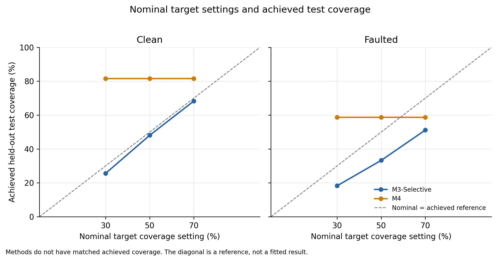
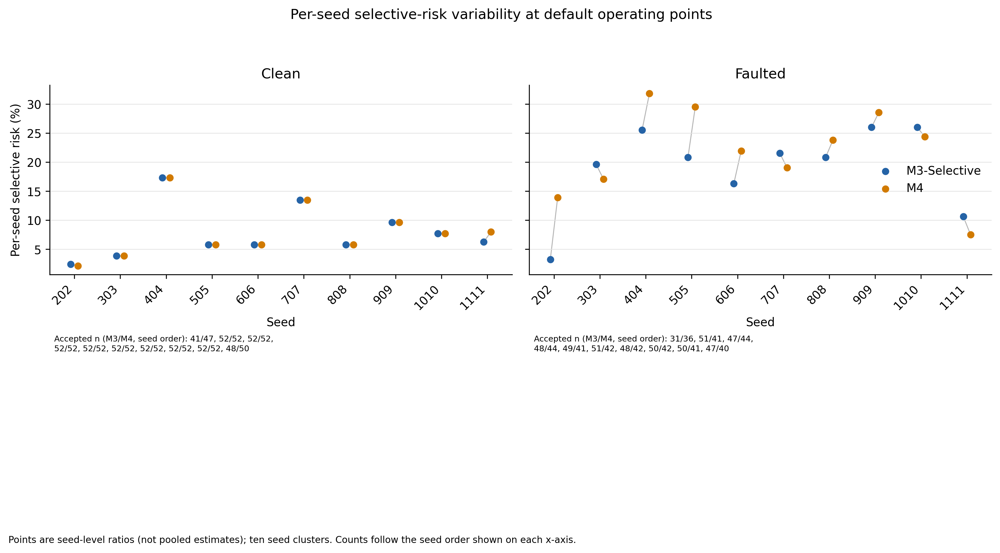

# A Synthetic Benchmark Study of Selective Pollution-Source Attribution Under Sensor Faults

*[First complete manuscript draft; not a final submission manuscript.]*

## Abstract

Pollution-source attribution from sparse monitoring networks is uncertain when multiple sources can produce similar downstream signals and when telemetry is incomplete or corrupted. Selective classification offers an explicit abstention option, but its practical value depends on the errors and coverage achieved under the operating conditions actually evaluated. We report a controlled synthetic benchmark comparing confidence-only selective attribution (M3-Selective) with a multi-signal selective attributor (M4) using an idealized one-dimensional advection–dispersion simulator. The configured experiment used ten seeds, 13 source classes, 20 episodes per class per seed, and stratified train/calibration/validation/test splits of 10/3/3/4 episodes per class. Each seed contributed 52 physical test episodes per condition; across ten seeds, these yielded 520 distinct held-out episodes per condition. Each episode was evaluated under both clean telemetry and a configured fault condition, yielding 1,040 condition-level records. The fault condition applied a stuck-value fault to `sensor_002` from 6 to 14 hours and 10% random missingness; telemetry delay was disabled.

Pooled forced-choice accuracy was 91.35% for both methods under clean conditions and 75.00% under faulted conditions. Pooled selective risk was 7.92% for M3-Selective and 7.99% for M4 in clean conditions, and 19.70% and 22.03%, respectively, under faulted conditions. Saved bootstrap estimates of the M4-minus-M3 pooled risk difference were +0.07 percentage points (95% CI −0.28 to +0.65) for clean and +2.33 points (95% CI −0.72 to +5.59) for faulted conditions. Both intervals include zero and are based on only ten seed clusters. Nominal target-coverage settings did not yield matched achieved test coverage; M4 test coverage repeated across all three settings within each condition, for reasons not resolved by saved validation diagnostics. These findings are descriptive for the specified synthetic benchmark and fault suite. They do not establish M4 superiority, real-world fault robustness, or performance on Noyyal River measurements.

## Keywords

Selective classification; abstention; pollution-source attribution; water-quality monitoring; sensor faults; advection–dispersion; synthetic benchmark; risk–coverage trade-off.

## 1. Introduction

Water-quality monitoring networks are used to detect changing conditions and support investigation of pollution events. Attribution is harder than detection: an anomalous concentration or water-quality signal does not by itself identify the responsible source. In a river, transport, dispersion, background conditions, and sparse observation locations can make source signatures overlap. Instrument and telemetry faults can further alter the observations available to an attribution method. A system that always assigns a source may therefore return an unsupported label when its evidence is weak.

Selective classification formalizes a reject or abstain option. Rather than returning an attribution for every observation, a selective predictor accepts only a subset of predictions. Its performance must be described jointly by coverage, the fraction of cases accepted, and selective risk, the error rate among accepted cases [1, 2]. Confidence thresholding is a common selective baseline; other methods integrate selection into model training or use additional uncertainty and input-quality signals [3, 4]. Calibration can help interpret probability scores, but calibration measured on one distribution does not guarantee calibration under a changed or corrupted input distribution [5–7].

The research question here concerns a controlled synthetic experiment, not a deployed environmental attribution service. The project’s geospatial application is documented as a screening prototype: its local source ranking and transport displays use heuristic or uncalibrated components, and its telemetry and representative facility records are simulated. The separate `research/` pipeline trains classifiers on synthetic source-labelled tracer episodes. Neither layer constitutes validation on measured Noyyal River sensor data.

This manuscript compares two selective operating policies in the saved confirmatory benchmark: M3-Selective, a confidence-only baseline, and M4, which adds probability calibration, a confidence-margin criterion, and sensor diagnostics. The empirical outcome is mixed and does not favor M4 on pooled selective risk. In addition, although the protocol includes nominal target-coverage settings, the saved achieved test coverage differs between methods at every setting. We therefore report target-labelled operating points as separate test evaluations, not as matched-coverage comparisons.

## 2. Related Work

### 2.1 Selective classification and abstention

The reject-option problem was formalized in early recognition theory as a trade-off between classification errors and rejection [1]. Modern selective-classification work commonly evaluates the risk–coverage curve. Geifman and El-Yaniv developed procedures for selective classification of deep networks using a confidence score and a desired risk level [2]. SelectiveNet instead trains an integrated predictor and rejector end-to-end, demonstrating that selection can be part of model fitting rather than only a post-hoc threshold [3]. Fisch et al. address calibration of uncertainty among accepted cases, emphasizing that selective accuracy does not alone establish that accepted confidence values are reliable [4].

These approaches provide relevant concepts and comparison methods, but none is the method evaluated here. The confirmatory experiment uses Random Forest classifiers and validation-selected thresholds; it does not implement SelectiveNet or establish a formal distribution-free risk guarantee. Its reported selective risk is an empirical ratio on the saved held-out synthetic episodes.

### 2.2 Calibration and distribution shift

Guo et al. studied calibration in modern neural networks and evaluated post-hoc temperature scaling on image and document classification tasks [5]. Ovadia et al. benchmarked predictive uncertainty under dataset shift, finding that uncertainty and calibration behavior may change as the test distribution moves from training conditions [6]. Liang et al. considered selective classification across in-distribution, label-shifted, and covariate-shifted data and proposed margin-based confidence scores [7]. Together, these studies motivate measuring selective behavior under altered inputs rather than assuming confidence transfers unchanged.

The present benchmark is narrower: its faulted test condition is defined by a specific stuck-value and random-missingness configuration. Training, calibration, and validation data are prepared from clean telemetry in both condition pipelines, while faults are applied to the condition-specific test partition. Thus the experiment evaluates transfer from clean development partitions to the configured faulted test observations, but does not characterize general calibration under environmental, seasonal, or field distribution shifts.

### 2.3 Sensor faults in environmental monitoring

Sensor-data quality reviews identify missing values, outliers, bias, and drift as recurring measurement problems and note that nonuniform evaluation and limited data access hinder comparison across fault-detection methods [8]. In high-frequency river water-quality monitoring, Leigh et al. evaluated methods using in-situ turbidity, conductivity, and river-level measurements; detection performance varied by anomaly type, with drift among the more difficult anomalies in the reported analysis [9]. A review focused on wastewater-treatment sensors describes a broad field of statistical, model-based, and data-driven fault detection and diagnosis [10].

This literature concerns identifying, correcting, or flagging data faults. The current study instead evaluates how source-attribution predictions and abstentions behave under one configured synthetic test fault suite. It is not a comprehensive sensor-diagnostic evaluation. Although the M4 code includes diagnostic checks for missingness, stuck readings, latency/data age, and drift, the saved confirmatory fault configuration does not test all of those fault modes.

### 2.4 Transport-based source attribution and synthetic evaluations

Inverse pollution-source research has long used advection–dispersion–reaction models to identify source locations or release histories from concentration observations [11]. Later studies have used transport simulations with numerical optimization, Bayesian inference, and genetic algorithms to estimate source location, time, or mass, including cases with river observations and sensitivity analysis [12, 13]. Zhang et al. explicitly study pollution-source detection using low-cost, low-accuracy sensors and couple data assimilation with inverse optimization [14]. More recently, Zhao et al. use a physics-informed neural network for river-channel source tracing and evaluate numerical and CFD-simulated cases, while noting limitations from simulated observations and simplified transport physics [15].

These works make clear that ADE-based synthetic evaluation and combinations of transport models with learned or optimized source inference are not, by themselves, novel. They also differ from this experiment: the saved benchmark casts attribution as a 13-class supervised classification problem on summaries of simulated tracer observations, then compares selective acceptance policies. It does not estimate continuous source location, release time, or mass from field measurements, and its simulator is not calibrated to Noyyal hydraulics.

## 3. Research Question and Contributions

### 3.1 Research question

**In a ten-seed synthetic one-dimensional advection–dispersion source-classification benchmark, how do confidence-only abstention and a multi-signal selective-attribution policy differ in pooled accepted-prediction error and achieved coverage under clean telemetry and one configured stuck-sensor/random-missingness condition?**

The target-coverage analyses also describe the held-out coverage obtained from validation-selected operating points labelled 0.30, 0.50, and 0.70. They do not estimate performance at matched achieved coverage.

### 3.2 Contributions

The defensible contribution is a controlled synthetic-benchmark comparison with paired clean/faulted test episodes, explicit abstention, pooled and seed-level results, and an audited bootstrap summary. The study documents both the observed risk–coverage behavior and limitations in the saved artifacts. It does not claim a new selective-classification method, a first-of-its-kind combination, an M4 advantage, or environmental field validation.

## 4. Methodology

### 4.1 Synthetic transport benchmark

The experiment plan describes a one-dimensional, finite-volume advection–dispersion screening simulator with lateral source injections. The simulated state is tracer concentration along an idealized channel, and observations are sampled at three stations. The simulator source documents a nominal 32 km domain, 25 m² cross-sectional area, 0.25 m/s flow velocity, and 4.5 m²/s longitudinal dispersion coefficient; these are synthetic model parameters, not calibrated estimates for the Noyyal River. The simulator also documents a 100 m spatial grid, 10 s numerical step, 24 h duration, and 5 min observation interval. Conductivity is retained only as an illustrative baseline and is not treated as a measured tracer concentration.

Each episode has a source-class label: 12 synthetic industrial-source candidates plus a background class, for 13 classes in total as reported in the confirmatory metadata. A class comprises source identity in this benchmark, not a verified facility identity or regulatory attribution. The simulator supplies known labels for controlled evaluation. Features are extracted only from observations and timestamps available at the decision horizon. The extractor includes per-station peak, mean, and integrated excursions; timing and duration summaries; missingness, latency, and data age; cross-station peak ratios and time lags; alarm indicators; and the maximum excursion. Future-arriving packets and source-generation metadata are excluded from prediction features by the documented extraction logic.

### 4.2 Compared methods

**M3-Selective (confidence-only baseline).** A conventional Random Forest is trained on the training partition. M3-Selective accepts the predicted top class when its confidence is at least a threshold selected on validation data; otherwise it abstains. It does not apply the M4 sensor-health gate or the top-two probability-margin criterion. The default threshold is selected to maximize validation coverage subject to a configured validation selective-risk target of 0.10. The target-coverage runs separately choose a confidence threshold whose validation coverage is closest to the requested target.

**M4 (multi-signal selective attributor).** M4 uses a Random Forest base classifier, temperature scaling fitted on the calibration partition, and validation-selected thresholds on calibrated top-class confidence and the difference between the largest and second-largest class probabilities. It also applies a deterministic sensor-diagnostic gate; failed health checks yield an abstention with a cause code. For the default operating point, thresholds are selected on validation data to maximize coverage subject to a configured maximum validation selective risk of 0.10. Target-coverage M4 runs separately select the threshold pair whose validation coverage is closest to each nominal target, with validation selective risk used to break equal-distance ties.

The comparison is between policies that differ in several components: temperature calibration, margin gating, and sensor diagnostics. The saved experiment does not isolate the causal contribution of each component. Also, the M4 forced-choice accuracy calculation uses its stored predicted source where available and falls back to the conventional classifier prediction when diagnostic abstention leaves no source; this metric is distinct from selective risk among accepted decisions.

### 4.3 Fault configuration and partition use

The confirmatory configuration defines a clean baseline and a faulted condition. In the faulted condition, the configured stuck-value fault affects `sensor_002` from 21,600 s through 50,400 s (6–14 h), and random missingness is configured at 0.10. Telemetry delay is disabled. In the inspected experiment runner, training, calibration, and validation features are prepared without injecting faults; the fault suite is applied to the condition-specific test records. Because runtime source provenance was not recorded, this description reflects the inspected implementation and saved configuration rather than a verified runtime source revision. Accordingly, the faulted result concerns transfer from clean development partitions to this configured corrupted test set. No saved result supports generalization to untested fault modes.

### 4.4 Outcomes

Forced-choice accuracy is the fraction of all 520 episodes with a correct class when a source label is supplied under the report's forced-choice convention. Coverage is the accepted count divided by the 520 test episodes. Selective risk is accepted attribution errors divided by accepted predictions. Thus selective risk has a method-specific accepted denominator; forced-choice accuracy and selective risk are different quantities.

All default counts and rates in Table 1 are pooled across the ten seeds. The per-seed mean is the unweighted average of ten seed-level risk ratios and is reported separately in Supplementary Figure S1; it is not interchangeable with pooled risk. For each target setting, achieved test coverage is accepted test predictions divided by 520. The nominal target is a validation operating-point label, not a guarantee of test coverage.

The saved bootstrap analysis reports M4-minus-M3 differences in pooled selective risk with 95% intervals and 1,000 valid replicates. Its resampling preserves method and condition pairing at physical episode clusters and resamples at the seed level; there are 520 episode clusters nested in only ten seeds. Intervals are reported as stored and interpreted descriptively. A paired resampling design does not make the methods' accepted subsets identical.

## 5. Experimental Setup

The confirmatory configuration lists seeds 202, 303, 404, 505, 606, 707, 808, 909, 1010, and 1111. It specifies 20 episodes per class per seed and a per-class split of 10 training, 3 calibration, 3 validation, and 4 test episodes. With 13 classes, this corresponds to 260 generated episodes per seed and 52 held-out episodes per seed per condition. The saved independent audit verifies 520 distinct physical test episodes, each evaluated in both clean and faulted conditions, and 1,040 condition-level prediction rows (520 per condition).

The run metadata marks the run complete and lists all ten seeds as completed. It records the config path and a matching configuration hash. However, no operating-system process exit code or source revision/source-file hash was recorded. Completion status is therefore the runner's saved status, not a recoverable process exit code; runtime source provenance remains unverified.

**Table 2. Confirmatory synthetic benchmark protocol.** The saved version is available as [Markdown](../../research/results/confirmatory_analysis_v2/figures_tables_v1/table_2_confirmatory_protocol.md) and [CSV](../../research/results/confirmatory_analysis_v2/figures_tables_v1/table_2_confirmatory_protocol.csv).

| Protocol item | Saved configuration/evidence |
|---|---|
| Seeds | 202, 303, 404, 505, 606, 707, 808, 909, 1010, 1111 (10) |
| Candidate classes | 13 (12 synthetic industrial dyeing clusters plus background; class names are not enumerated in config) |
| Episodes per class per seed | 20 |
| Per-class split | 10 train / 3 calibration / 3 validation / 4 test |
| Test episodes per seed per condition | 52 |
| Physical test episodes | 520 paired episodes, evaluated in both conditions |
| Condition-level records | 520 clean + 520 faulted = 1,040 |
| Faulted test configuration | Stuck value at `sensor_002`, 6–14 h; 10% random missingness; telemetry delay disabled |
| Nominal target settings | 0.30, 0.50, 0.70 |
| Data basis | Synthetic 1D ADE; not measured Noyyal sensor observations |

*The number of candidate classes and 52 test episodes per seed are verified in the saved confirmatory report and audit; the configuration itself specifies 20 episodes per class, 13-class design is reported in run metadata, and split allocation.*

## 6. Results

### 6.1 Default pooled performance

Table 1 reports pooled default operating-point results across 520 test episodes per condition. In clean conditions, both methods had 91.35% forced-choice accuracy. M3-Selective accepted 505 and abstained on 15 episodes, with 40 accepted errors and 7.92% pooled selective risk. M4 accepted 513 and abstained on 7, with 41 accepted errors and 7.99% pooled selective risk. Under the configured faulted condition, both methods had 75.00% forced-choice accuracy. M3-Selective accepted 472 and abstained on 48, with 93 accepted errors and 19.70% risk; M4 accepted 413 and abstained on 107, with 91 accepted errors and 22.03% risk.

M4's pooled selective-risk point estimate is higher in both conditions. Under faults, it accepts fewer episodes while its accepted subset has higher pooled risk than the M3-Selective accepted subset. These are descriptive results at the saved default operating points; they do not establish superiority or causal effects of any single M4 component.

**Table 1. Pooled default selective-attribution performance by condition.** Selective risk is accepted errors divided by accepted predictions. Accuracy, acceptance, abstention, and risk are pooled across 520 episodes per condition. The existing assets are available as [Markdown](../../research/results/confirmatory_analysis_v2/figures_tables_v1/table_1_default_selective_performance.md) and [CSV](../../research/results/confirmatory_analysis_v2/figures_tables_v1/table_1_default_selective_performance.csv).

| Condition | Method | Forced-choice accuracy | Accepted / abstained | Accepted errors | Pooled selective risk |
|---|---|---:|---:|---:|---:|
| Clean | M3-Selective | 91.35% | 505 / 15 | 40 | 7.92% |
| Clean | M4 | 91.35% | 513 / 7 | 41 | 7.99% |
| Faulted | M3-Selective | 75.00% | 472 / 48 | 93 | 19.70% |
| Faulted | M4 | 75.00% | 413 / 107 | 91 | 22.03% |

### 6.2 Bootstrap risk differences

The saved bootstrap summary reports the M4-minus-M3 pooled selective-risk difference as +0.07 percentage points (95% CI −0.28 to +0.65) in clean conditions and +2.33 percentage points (95% CI −0.72 to +5.59) in faulted conditions. Each interval used 1,000 valid replicates out of 1,000 declared. Both intervals include zero. Because selective risk is conditional on each method's own accepted subset, these differences are differences between method-specific conditional risks, not paired errors on a common accepted subset. The saved bootstrap has only ten seed clusters, so its intervals should be treated as descriptive uncertainty for this benchmark, not as a formal superiority decision.

*Figure 1. Pooled M4-minus-M3 selective-risk difference with saved 95% bootstrap interval. The interval inputs are from `bootstrap_summary.json`; both intervals include zero and are descriptive given ten seed clusters. Vector version: [`figure_1_default_risk_difference.pdf`](../../research/results/confirmatory_analysis_v2/figures_tables_v1/figure_1_default_risk_difference.pdf).*

### 6.3 Nominal targets and achieved test coverage

Target labels did not yield matched test coverage. In clean conditions, M3-Selective achieved 25.58%, 48.08%, and 68.27% coverage at nominal settings 0.30, 0.50, and 0.70, respectively; M4 achieved 81.54% at all three. Under the faulted condition, M3-Selective achieved 18.27%, 33.27%, and 51.15%, while M4 achieved 58.65% at all three. These are achieved held-out coverages following validation tuning; the nominal settings should not be interpreted as test coverage or as method-matched operating points.

Saved per-seed records show that M4 used the same threshold pair at all three target settings within each seed, producing the repeated pooled coverage. The source code calls the target-coverage tuner separately for each target, but the saved results do not include target-specific validation coverage or tuning-grid scores. Therefore, why the tuner selected those same threshold pairs remains unresolved. The original faulted 70% “infeasible” label and approximately 61.5% maximum-coverage statement are unsupported by the saved validation evidence and are not treated as findings. Test coverage of 58.65% at that target does not establish a validation feasibility limit or structural ceiling.

*Figure 2. Nominal target settings versus achieved test coverage. The figure shows that target labels and test coverage differ and that method coverages are not matched. It does not support a matched-coverage comparison. Vector version: [`figure_2_target_vs_achieved_coverage.pdf`](../../research/results/confirmatory_analysis_v2/figures_tables_v1/figure_2_target_vs_achieved_coverage.pdf).*

### 6.4 Per-seed variability

The ten seed-level selective-risk ratios vary across seeds and between methods. Supplementary Figure S1 displays paired per-seed values and accepted counts by method. These points are unweighted seed-level ratios, not pooled estimates; they should not be substituted for the results in Table 1. Ten seed clusters provide limited information about variability beyond this specified benchmark.

*Supplementary Figure S1. Per-seed selective risks and accepted counts, separated by condition. The plot describes ten seed clusters and does not display pooled estimates or inferential intervals. Vector version: [`figure_s1_seed_risk_variability.pdf`](../../research/results/confirmatory_analysis_v2/figures_tables_v1/figure_s1_seed_risk_variability.pdf).*

## 7. Discussion

The default pooled results do not show that adding calibration, a margin criterion, and sensor diagnostics lowered selective risk relative to confidence-only abstention. M4's risk was 0.07 percentage points higher in clean conditions and 2.33 points higher in the configured faulted condition. The saved bootstrap intervals include zero and have only ten seed clusters. The experiment consequently provides no basis for claiming that M4 reduces accepted attribution errors in this benchmark, much less that it improves performance in real monitoring.

The faulted condition changed both accuracy and selective behavior. Forced-choice accuracy fell from 91.35% to 75.00% for both methods between the clean and configured faulted tests. M4 abstained on more faulted episodes than M3-Selective (107 versus 48), but the accepted M4 predictions did not have lower pooled selective risk. This describes the net policy outputs; because M4 differs from M3-Selective in more than one component and no component ablation is reported, it does not identify which mechanism caused these outcomes.

The target-coverage analysis also does not support a matched-coverage risk comparison. At every nominal target, test coverage differed between the methods. M4 repeated its coverage at all three settings, while M3-Selective coverage increased across the settings. The saved threshold pairs establish that M4 reused the same pair per seed, but no target-specific validation diagnostics explain the repeated choices. A follow-up should preserve validation predictions and grid evaluations, pre-specify how target coverage is achieved, and report methods at comparable achieved test coverage without tuning on test outcomes.

The selected literature shows active work on reject-option classification, calibration under shift, water-quality sensor anomaly handling, and physical source inversion. A contribution should therefore be framed around the controlled evaluation and its evidence limits, not as the first combination of these ideas. The distinguishing experiment available here is a source-labelled synthetic ADE benchmark that measures accepted attribution risk and coverage under one configured test fault suite. A useful next scientific step would test whether abstention can improve the risk–coverage trade-off at comparable achieved coverage across more independent seeds and a broader, pre-specified fault matrix.

## 8. Limitations and Threats to Validity

### 8.1 Synthetic and physical-model validity

The simulator is an idealized one-dimensional ADE screening model with synthetic source classes and tracer signals. It is not a calibrated hydraulic or water-quality model of the Noyyal River. The application documentation separately describes simulated telemetry and representative facility records; geographic coordinates or visualized river pathways do not make those records measured environmental observations. No conclusion about real Noyyal water quality, actual polluter identity, regulatory attribution, or field response follows from this benchmark.

### 8.2 Fault-suite coverage

The configured fault suite includes a single stuck-value sensor at `sensor_002` and 10% random missingness; delay is disabled. It does not evaluate the full set of faults discussed in the experiment-plan narrative, including drift, additive noise, multiple severities of burst dropout, or telemetry delay. Results cannot be generalized to those untested modes or to real sensor faults.

### 8.3 Sample size, dependence, and uncertainty

There are 520 physical episode clusters but only ten seed clusters. Bootstrap resampling preserves the saved paired episode/method/condition structure and reports 1,000 valid replicates, but this does not create additional independent seeds. Both default pooled risk-difference intervals include zero. They should be interpreted cautiously as descriptive uncertainty, not proof of equivalence, superiority, or a population-level effect.

### 8.4 Operating-point and model-comparison limitations

The nominal target settings did not produce matched achieved test coverage. Repeated M4 thresholds across target settings remain unexplained because per-target validation coverage and tuning-grid results are unavailable. The faulted 70% infeasibility label and approximately 61.5% ceiling in the original reporting code are unsupported and have been flagged by the audit. Moreover, the M3-Selective/M4 comparison changes multiple components; without ablations, it cannot isolate the impact of temperature scaling, margin gating, or sensor diagnostics.

### 8.5 Reproducibility and provenance

The saved metadata and log mark the run complete and enumerate all ten seeds. However, the operating-system process exit code and runtime source provenance were not recorded. The configuration hash matches the current config, but that does not identify the exact source revision used to generate the outputs. Validation predictions and tuning-grid details are also unavailable. These provenance and diagnostics gaps limit independent reconstruction of the run and threshold-selection process.

## 9. Conclusion

This manuscript reports a ten-seed, 13-class synthetic ADE benchmark comparing confidence-only abstention with a multi-signal selective attribution policy under clean telemetry and a configured stuck-sensor/random-missingness test condition. Both methods had the same forced-choice accuracy in each condition. M4 did not demonstrate lower pooled selective risk than M3-Selective in either condition, and the saved bootstrap intervals are descriptive and based on only ten seed clusters. The nominal target settings did not yield matched achieved test coverage, and the reason for repeated M4 thresholds remains unresolved.

The evidence supports a descriptive account of risk, coverage, and abstention for this synthetic setup. It does not demonstrate M4 superiority, matched-coverage advantage, robustness to untested faults, or validation on real Noyyal observations. Stronger claims require additional independent seeds, component ablations, validation tuning diagnostics, broader fault tests, physical-model validation, and field observations with verified source labels.

## 10. References

1. C. K. Chow. “On optimum recognition error and reject tradeoff.” *IEEE Transactions on Information Theory*, 16(1), 41–46 (1970). [https://doi.org/10.1109/TIT.1970.1054406](https://doi.org/10.1109/TIT.1970.1054406). **[AUTHOR TO VERIFY: direct IEEE metadata access was unavailable during the manuscript audit.]**
2. Yonatan Geifman and Ran El-Yaniv. “Selective Classification for Deep Neural Networks.” *Advances in Neural Information Processing Systems 30* (2017). [Publisher record](https://papers.nips.cc/paper_files/paper/2017/hash/4a8423d5e91fda00bb7e46540e2b0cf1-Abstract.html).
3. Yonatan Geifman and Ran El-Yaniv. “SelectiveNet: A Deep Neural Network with an Integrated Reject Option.” *Proceedings of the 36th International Conference on Machine Learning*, PMLR 97, 2151–2159 (2019). [https://proceedings.mlr.press/v97/geifman19a.html](https://proceedings.mlr.press/v97/geifman19a.html).
4. Adam Fisch, Tommi Jaakkola, and Regina Barzilay. “Calibrated Selective Classification.” *Transactions on Machine Learning Research* (2022). [https://openreview.net/forum?id=zFhNBs8GaV](https://openreview.net/forum?id=zFhNBs8GaV).
5. Chuan Guo, Geoff Pleiss, Yu Sun, and Kilian Q. Weinberger. “On Calibration of Modern Neural Networks.” *Proceedings of the 34th International Conference on Machine Learning*, PMLR 70, 1321–1330 (2017). [https://proceedings.mlr.press/v70/guo17a.html](https://proceedings.mlr.press/v70/guo17a.html).
6. Yaniv Ovadia, Emily Fertig, Jie Ren, Zachary Nado, D. Sculley, Sebastian Nowozin, Joshua V. Dillon, Balaji Lakshminarayanan, and Jasper Snoek. “Can You Trust Your Model’s Uncertainty? Evaluating Predictive Uncertainty Under Dataset Shift.” *Advances in Neural Information Processing Systems 32* (2019). [Publisher record](https://papers.neurips.cc/paper/2019/hash/8558cb408c1d76621371888657d2eb1d-Abstract.html).
7. Hengyue Liang, Le Peng, and Ju Sun. “Selective Classification Under Distribution Shifts.” *Transactions on Machine Learning Research* (2024). [https://openreview.net/forum?id=dmxMGW6J7N](https://openreview.net/forum?id=dmxMGW6J7N).
8. Hui Yie Teh, Andreas W. Kempa-Liehr, and Kevin I-Kai Wang. “Sensor data quality: a systematic review.” *Journal of Big Data* 7, article 11 (2020). [https://doi.org/10.1186/s40537-020-0285-1](https://doi.org/10.1186/s40537-020-0285-1).
9. Catherine Leigh, Omar Alsibai, Rob J. Hyndman, Sevvandi Kandanaarachchi, Olivia C. King, James M. McGree, Catherine Neelamraju, Jennifer Strauss, Priyanga Dilini Talagala, Ryan S. Turner, Kerrie Mengersen, and Erin E. Peterson. “A framework for automated anomaly detection in high frequency water-quality data from in situ sensors.” *Science of the Total Environment* 664, 885–898 (2019). [https://doi.org/10.1016/j.scitotenv.2019.02.085](https://doi.org/10.1016/j.scitotenv.2019.02.085).
10. Shanshan Chen, Xiaodong Wang, Xuejun Bi, and Zakhar Maletskyi. “Sensor fault characteristics and fault detection in wastewater treatment plants: Current status and trend analysis.” *Journal of Process Control* 155, article 103574 (2025). [https://doi.org/10.1016/j.jprocont.2025.103574](https://doi.org/10.1016/j.jprocont.2025.103574).
11. Abdellatif El Badia and Adel Hamdi. “Inverse source problem in an advection–dispersion–reaction system: application to water pollution.” *Inverse Problems* 23(5), 2103–2120 (2007). [https://doi.org/10.1088/0266-5611/23/5/017](https://doi.org/10.1088/0266-5611/23/5/017).
12. Bruno Carlos Lugão, Diego Campos Knupp, and Pedro Paulo G. W. Rodriges. “Direct and inverse simulation applied to the identification and quantification of point pollution sources in rivers.” *Environmental Modelling & Software* 156, article 105488 (2022). [https://doi.org/10.1016/j.envsoft.2022.105488](https://doi.org/10.1016/j.envsoft.2022.105488).
13. Yinying Zhu, Zhi Chen, and Zunaira Asif. “Identification of point source emission in river pollution incidents based on Bayesian inference and genetic algorithm: Inverse modeling, sensitivity, and uncertainty analysis.” *Environmental Pollution* 285, article 117497 (2021). [https://doi.org/10.1016/j.envpol.2021.117497](https://doi.org/10.1016/j.envpol.2021.117497).
14. Chi Zhang, Zhe Zhu, Yu Li, Erhu Du, Yuheng Sun, and Zhenyao Liu. “Pollution Source Detection With Low-Cost Low-Accuracy Sensors Through Coupling Forward Data Assimilation and Inverse Optimization.” *Water Resources Research* 60, e2023WR036834 (2024). [https://doi.org/10.1029/2023WR036834](https://doi.org/10.1029/2023WR036834).
15. Xu Zhao, Haifei Liu, Fei Leng, Wei Yang, Xinan Yin, and Yujun Yi. “Source Tracing for Pollutants in River Channels Based on a Physics-Informed Neural Network.” *Water Resources Research* 62(2), e2025WR040846 (2026). [https://doi.org/10.1029/2025WR040846](https://doi.org/10.1029/2025WR040846).

## Author-verification items and export notes

- **[AUTHOR TO VERIFY]** Author names, affiliations, corresponding author, acknowledgements/funding, and target journal requirements.
- **[NOT AVAILABLE IN CURRENT EVIDENCE]** Operating-system exit code and exact source revision/hash used by the completed run.
- **[NOT AVAILABLE IN CURRENT EVIDENCE]** Target-specific validation predictions/grid records needed to explain repeated M4 threshold pairs.
- **[AUTHOR TO VERIFY]** Confirm that the simulator defaults documented in `research/simulation/river_ade_simulator.py` match the exact runtime settings; the saved runtime source provenance is absent.
- **[AUTHOR TO VERIFY]** Review the final figure/table numbering, pagination, image resolution requirements, and supplementary-material convention for the selected journal.
- The Markdown image and table links above are relative to this file and resolve from `docs/research/` in the repository. For export, preserve the repository-relative paths or copy the PNG/PDF and CSV/Markdown assets into the manuscript package; adjust paths only if the submission package layout changes.
