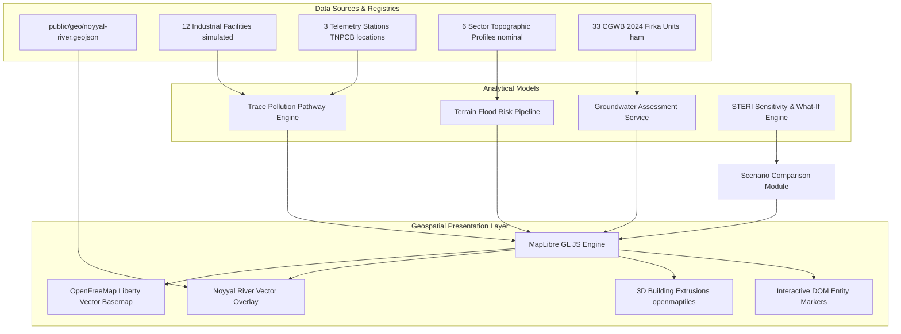
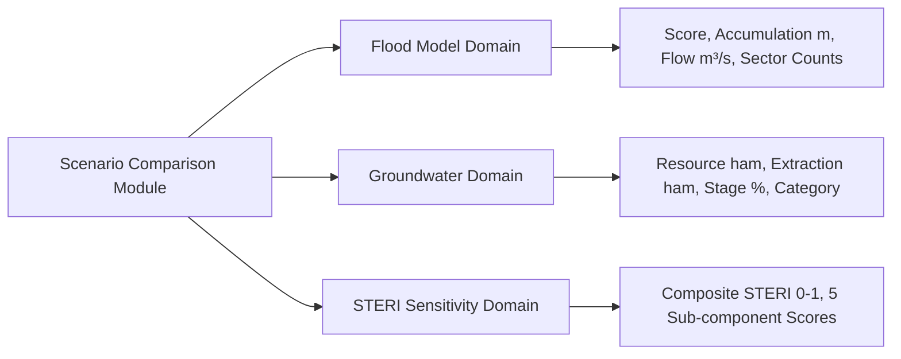

# Methodology and Analytical Architecture: Smart Tiruppur / NoyyalSense

**Project:** Smart Tiruppur Environmental Digital Twin / NoyyalSense  
**Document Type:** Technical Methodology & System Architecture  
**Target Audience:** Academic Reviewers, Environmental Engineers, Geospatial System Auditors  
**Last Updated:** October 2026  
**Implementation Source:** `app/terrain-map-prototype/page.tsx`, `lib/digital-twin/`, `lib/flood/`, `lib/scenarios/`, `lib/steri/`, `lib/geo/`

---

## 1. Executive Summary & Architectural Overview

The **Smart Tiruppur Environmental Digital Twin** (NoyyalSense) is a geospatial decision-support prototype designed for multi-scale environmental risk monitoring in the industrial textile manufacturing hub of Tiruppur, Tamil Nadu, India.

The platform couples:
1. **Interactive Geospatial Visualization:** Client-side vector tile and GeoJSON rendering powered by MapLibre GL JS, OpenFreeMap, and OpenStreetMap data.
2. **Industrial Attribution & Pollution Pathway Modeling:** River-snapping advective transit estimations linking industrial outfalls to downstream telemetry stations.
3. **Terrain-Based Flood Hazard Estimation:** Multi-criteria accumulation scoring across six vulnerable urban-drainage sectors.
4. **Groundwater Resource Stress Assessment:** Official 2024 Central Ground Water Board (CGWB) administrative Firka assessment data coupled with scenario extraction multipliers.
5. **Scenario Sensitivity Analysis:** Comparative baseline-versus-alternative stress tests across hydrological, extraction, and multi-criteria environmental risk parameters (STERI).

---

## 2. Geospatial Map Architecture & Rendering

### 2.1 Map Engine and Vector Basemap
* **Engine:** MapLibre GL JS (v4.7.1) rendering to a WebGL context.
* **Basemap Service:** OpenFreeMap Liberty style (`https://tiles.openfreemap.org/styles/liberty`).
* **Tile Schema:** OpenMapTiles vector tile schema, serving road hierarchies, hydrography, place labels, and building footprints.
* **Center Georeference:** Latitude $11.1085^\circ\text{ N}$, Longitude $77.3411^\circ\text{ E}$ (Tiruppur City Hall / Noyyal Basin core).
* **Camera Modes:**
  * **City Overview:** Center `[77.3411, 11.1085]`, Zoom `12.4`, Pitch `0.0^\circ`, Bearing `0.0^\circ` (orthographic 2D inspection).
  * **Urban Detail:** Center `[77.3520, 11.1050]`, Zoom `15.8`, Pitch `52.0^\circ`, Bearing `-18.0^\circ` (oblique perspective for building extrusions and outfall geometry).

### 2.2 River Geometry
* **File:** `public/geo/noyyal-river.geojson` (220 KB GeoJSON LineString).
* **Source:** Derived from OpenStreetMap hydrographic data tracing the main stem of the Noyyal River through the Tiruppur urban corridor.
* **Rendering:** Dual-layer rendering consisting of:
  * A semi-transparent outer river buffer (`#0284c7`, opacity `0.35`, width `14px`).
  * A crisp inner river channel (`#0284c7`, opacity `0.85`, width `3.5px`).

### 2.3 3D Building Extrusions & Height Limitations
* **Layer Source:** OpenMapTiles `building` vector tile layer.
* **Extrusion Property:** Built with MapLibre `fill-extrusion` layer type:
  * Height property: `["coalesce", ["get", "render_height"], 16]`.
  * Base height: `["coalesce", ["get", "render_min_height"], 0]`.
* **Scientific Caveat:** OpenStreetMap building footprints in Tiruppur frequently lack calibrated LiDAR or photogrammetric building height tags (`height` or `building:levels`). Where `render_height` is absent, the engine falls back to an **illustrative display height of 16 meters** (~4–5 storeys) to provide urban massing context. **This fallback is explicitly designated as an estimated visual height, not a measured architectural survey.**

---

## 3. Industrial Facility & Monitoring Station Registries

### 3.1 Industrial Facilities (12 Units)
* **Module:** `lib/digital-twin/industrial.ts` (`INDUSTRIAL_UNITS_GEO`).
* **Provenance Classification:** **Synthetic Demonstration Dataset (`sourceType: "SIMULATED"`).**
* **Attributes:** Unit ID (`unit_001` through `unit_012`), industrial cluster name, latitude/longitude, industrial classification (Dyeing & Bleaching, ZLD Facility, CETP Member), compliance status (`COMPLIANT`, `WARNING`, `INVESTIGATE`), effluent flow rate ($m^3/\text{day}$), water reuse percentage (%), and demonstration confidence score (0.60–0.75).
* **Outfall Model:** Each facility possesses an associated synthetic outfall point (`INDUSTRIAL_OUTFALLS`) offset slightly towards the drainage corridor, with a nominal pollutant indicator concentration and flow rate.
* **Known Limitation:** These 12 facilities represent representative manufacturing archetypes within Tiruppur's textile dyeing clusters (Arulpuram, Veerapandi, Kasipalayam, Angeripalayam, Rayapuram, etc.). They do not constitute an official state registry of non-compliant units.

### 3.2 Telemetry Monitoring Stations (3 Mapped + 1 Unmapped)
* **Module:** `lib/digital-twin/sensors.ts` (`ENVIRONMENTAL_SENSOR_REGISTRY`).
* **Provenance Classification:** **Simulated Sensor Network at Real Geographic Coordinates.**
* **Mapped Stations:**
  1. `sensor_001` (`S_A`): **Mangalam Telemetry Station** ($11.10651^\circ\text{ N}, 77.26001^\circ\text{ E}$) — Upstream entry station.
  2. `sensor_002` (`S_B`): **Kasipalayam Bridge Telemetry** ($11.11975^\circ\text{ N}, 77.39716^\circ\text{ E}$) — Urban/industrial exit station.
  3. `sensor_003` (`S_C`): **Orathapalayam Reservoir Exit** ($11.11084^\circ\text{ N}, 77.53981^\circ\text{ E}$) — Downstream reservoir outflow.
* **Geographic Alignment:** Coordinates match the real Tamil Nadu Pollution Control Board (TNPCB) National Water Quality Monitoring Programme (NWMP) sampling locations documented in `public/geo/tnpcb-noyyal-stations.json`.
* **Readings:** The associated telemetry parameters (pH, Electrical Conductivity in $\mu S/\text{cm}$, Turbidity in NTU, Streamflow in $m^3/\text{s}$) are **simulated demonstration readings**, pending integration of live telemetry streams.
* **Logical Stream $S_D$:** Stream `S_D` is intentionally unmapped to physical geography and retained exclusively within the backend monitoring workspace to prevent spurious coordinate fabrication.

---

## 4. Trace Pollution & Downstream Transport Modeling

### 4.1 Snapping and Geometric Projection
* When an industrial facility is selected, the system calculates the nearest geodesic coordinate on the Noyyal River centerline polyline.
* **Snapping Threshold:** $\le 2.50\text{ km}$ geodesic distance from the river corridor.
* **Pathway Generation:** If within the threshold, a two-segment path is rendered:
  1. An overland discharge connector from the industrial unit to the snapped river coordinate.
  2. An advective instream transport segment following the river centerline downstream to the next sensor station.

### 4.2 Distance Decay & Relative Source Influence
* In the 3D analytical engine (`lib/digital-twin/sensors.ts`), source influence at downstream station $j$ from outfall $i$ is calculated via exponential attenuation:
  $$I_{i,j} = \begin{cases} S_i \times \exp\left(-\frac{\Delta x_{i,j}}{D_0}\right), & \text{if station is downstream } (\Delta x_{i,j} \ge 0) \\ 0, & \text{otherwise} \end{cases}$$
  Where:
  * $S_i$ is the normalized source discharge strength ($\text{flow rate} \times \text{concentration}$).
  * $\Delta x_{i,j}$ is river chainage distance in meters.
  * $D_0 = 0.25 \times L_{\text{river}}$ is the characteristic longitudinal attenuation length.

### 4.3 Travel-Time & Velocity Assumptions
* The prototype displays estimated transit time:
  $$t_{\text{transit}} = \frac{\Delta x}{v_{\text{nominal}}}$$
* **Nominal River Velocity:** Set to a constant $v = 0.45\text{ m/s}$ (routine baseflow).
* **Crucial Scientific Disclosure:** This travel time is a **simplified screening estimate**, not a calibrated 1D/2D hydrodynamic model (e.g., HEC-RAS or MIKE 11). It does not account for variable cross-sectional bathymetry, Manning roughness coefficients, or seasonal discharge transients.

### 4.4 Pathway Availability & Fallback Handling
* If a facility lies $> 2.50\text{ km}$ from the digitized river centerline, the system displays an explicit notification:
  > *"No direct surface pathway mapped within 2.5 km river corridor. Facility operates under closed-loop Zero Liquid Discharge (ZLD) or discharges to regional CETP conveyance."*
* This guarantees that artificial pathways are never fabricated across distant topography.

---

## 5. Flood Exposure & Multi-Criteria Accumulation Estimation

### 5.1 Pipeline Description
* **Module:** `lib/flood/engine.ts` (`runFloodAnalysisPipeline()`).
* **Model Type:** Multi-criteria terrain-based low-elevation runoff accumulation estimation.
* **Scenarios Evaluated:**
  * `BASELINE`: 0 mm/day rainfall, 10 $m^3/\text{s}$ baseflow.
  * `MODERATE_RAIN`: 50 mm/day rainfall (6 h duration), 35 $m^3/\text{s}$ river flow.
  * `HEAVY_RAIN`: 150 mm/day rainfall (12 h duration), 85 $m^3/\text{s}$ river flow.
  * `EXTREME_RAIN`: 250 mm/day rainfall (24 h duration), 160 $m^3/\text{s}$ river flow.

### 5.2 Evaluated Sector Locations
The model assesses six critical sectors across the Tiruppur urban topography:
1. **Kasipalayam Noyyal Exit Trough** (Elevation: 290 m ASL, Slope: $0.8^\circ$, River Distance: 45 m).
2. **Angeripalayam Fabric Sector Slope** (Elevation: 298 m ASL, Slope: $1.8^\circ$, River Distance: 120 m).
3. **Tiruppur South Plain** (Elevation: 305 m ASL, Slope: $2.2^\circ$, River Distance: 450 m).
4. **Tiruppur North Foothills** (Elevation: 318 m ASL, Slope: $3.5^\circ$, River Distance: 620 m).
5. **Arulpuram CETP Industrial Sector** (Elevation: 312 m ASL, Slope: $2.5^\circ$, River Distance: 800 m).
6. **Mangalam Upstream Floodplain** (Elevation: 308 m ASL, Slope: $1.2^\circ$, River Distance: 20 m).

### 5.3 Mathematical Scoring Formulation
For sector $k$:
$$\text{ElevDepressionFactor} = \max\left(0, \frac{315 - \text{elev}_k}{25}\right)$$
$$\text{RiverProximityFactor} = \max\left(0, \frac{500 - \text{dist}_k}{500}\right)$$
$$\text{RainFactor} = \frac{\text{rainfall}_{\text{mm/day}}}{250}$$
$$\text{AccumDepth} = (0.8 \times \text{ElevDepression} + 0.6 \times \text{RiverProximity}) \times \text{RainFactor} \times 1.8$$
$$\text{Score}_k = \min\left(1.0, \frac{\text{AccumDepth}}{1.5}\right)$$

### 5.4 Risk Classification
* $\text{Score} < 0.20$: **LOW**
* $0.20 \le \text{Score} < 0.40$: **MODERATE**
* $0.40 \le \text{Score} < 0.60$: **HIGH**
* $0.60 \le \text{Score} < 0.80$: **VERY HIGH**
* $\ge 0.80$: **CRITICAL**

### 5.5 Scientific Scope & Explicit Disclosures
* **Point-Based Indicators:** The flood model produces scalar indicators at the **six sector point coordinates**.
* **No Synthetic Flood Polygons:** The software intentionally does **not** generate polygon inundation boundaries or flood depth rasters, as doing so without validated hydraulic simulation would produce false precision.
* **Elevation Constants:** Sector elevations and slopes represent established morphological profile constants rather than a dynamically sampled real-time DEM raster.

---

## 6. Groundwater Assessment & Administrative Resource Balancing

### 6.1 Data Authority & Assessment Year
* **Source Authority:** Central Ground Water Board (CGWB), Ministry of Jal Shakti, Government of India.
* **Assessment Report:** *National Compilation on Dynamic Ground Water Resources of India (2024)*.
* **Administrative Division:** 33 Revenue Firkas covering the Tiruppur administrative district.
* **Metric Units:** **Hectare-meters (ham)**, where $1\text{ ham} = 10,000\text{ m}^3 = 0.01\text{ MCM}$.

### 6.2 Official Evaluation Metrics
For each assessment unit:
1. **Total Annual Extractable Groundwater Resource ($R_{\text{ext}}$, ham):** Net annual replenishable recharge available for extraction.
2. **Current Annual Groundwater Extraction ($E_{\text{tot}}$, ham):** Combined draft for irrigation, industrial, and domestic uses.
3. **Stage of Groundwater Extraction ($S_{\text{gw}}$, %):**
   $$S_{\text{gw}} = \left(\frac{E_{\text{tot}}}{R_{\text{ext}}}\right) \times 100\%$$
4. **Net Annual Groundwater Balance ($B_{\text{gw}}$, ham):**
   $$B_{\text{gw}} = R_{\text{ext}} - E_{\text{tot}}$$
   (A negative balance denotes an extraction deficit leading to aquifer drawdown).

### 6.3 CGWB Categorization Criteria
* **Safe:** $S_{\text{gw}} < 70\%$ (Long-term recharge exceeds extraction).
* **Semi-Critical:** $70\% \le S_{\text{gw}} < 90\%$ (Extraction approaching annual replenishment).
* **Critical:** $90\% \le S_{\text{gw}} < 100\%$ (Extraction at near parity with recharge).
* **Over-Exploited:** $S_{\text{gw}} \ge 100\%$ (Extraction exceeds annual replenishable recharge, causing systemic water table decline).

### 6.4 Service Integration & Scenario Multipliers
* **API Endpoints:**
  * `GET /zones` $\to$ Returns list of 33 administrative Firkas.
  * `GET /zones/{id}/assess?extraction_multiplier={m}` $\to$ Returns baseline and scenario-scaled draft calculations.
* **Supported Multipliers:**
  * $0.8\times$ (20% draft reduction via enhanced recycling or recharge).
  * $1.0\times$ (Official CGWB 2024 Baseline).
  * $1.2\times$ (20% draft increase simulating dry-season or industrial stress).
* **Scientific Caveat:** The $0.8\times$ and $1.2\times$ multipliers are **hypothetical scenario sensitivity factors**, not field-observed changes in groundwater draft.

---

## 7. Scenario Comparison & Sensitivity Framework

### 7.1 Architecture of Comparison
The Scenario Comparison module enables side-by-side evaluation between a baseline condition and an alternative scenario. Rather than forcing disparate physical domains into an artificial unified score, the system enforces **scientific domain segregation**:

### 7.2 Mathematical Comparison Metrics
For any numeric metric $M$:
* **Absolute Change:** $\Delta = M_{\text{alt}} - M_{\text{base}}$
* **Percentage Change:**
  $$\%\Delta = \begin{cases} \left(\frac{M_{\text{alt}} - M_{\text{base}}}{M_{\text{base}}}\right) \times 100\%, & \text{if } M_{\text{base}} \neq 0 \\ \text{"N/A (base 0)"}, & \text{if } M_{\text{base}} = 0 \end{cases}$$
* **Categorical Transition:** Tracked as $\text{Category}_{\text{base}} \to \text{Category}_{\text{alt}}$.

### 7.3 STERI Multi-Criteria Risk Index Formulation
The Smart Tiruppur Environmental Risk Index (STERI) provides multi-criteria risk aggregation:
$$\text{STERI} = \sum_{k=1}^K w_k \times S_k$$
Subject to $\sum_{k=1}^K w_k = 1.0$, where $S_k \in [0.0, 1.0]$.

* **Component Weights (What-If Engine, `lib/scenarios/engine.ts`):**
  * Industrial Pollution ($w_{\text{poll}} = 0.25$)
  * Flood Hazard ($w_{\text{flood}} = 0.20$)
  * Groundwater Depletion ($w_{\text{gw}} = 0.20$)
  * Water Quality Deterioration ($w_{\text{wq}} = 0.20$)
  * Citizen Complaints ($w_{\text{comp}} = 0.15$)
* **Component Weights (Dynamic Research Engine, `lib/steri/calculator.ts`):**
  * Pollution ($0.20$), Water Quality ($0.20$), Flood ($0.15$), Groundwater ($0.15$), Industrial Pressure ($0.15$), Complaints ($0.15$).

---

## 8. Summary of Model Assumptions & Scientific Integrity Principles

| Component | What the Software Implements | What the Software Explicitly Avoids |
| :--- | :--- | :--- |
| **Basemap & Buildings** | OpenFreeMap Liberty tiles; 16m fallback display height clearly noted as estimated visual height. | Fabricating individual building height surveys or cadastral records. |
| **Industrial Units** | 12 representative textile facilities with simulated flow, reuse, and compliance indicators. | Presenting units as a legally binding regulatory citation list. |
| **Monitoring Stations** | 3 stations at official TNPCB coordinates with simulated water quality readings. | Claiming live real-time CPCB sensor hardware telemetry. |
| **Pollution Tracing** | Snapped river centerline path with exponential distance decay and nominal velocity ($0.45\text{ m/s}$). | Claiming 2D hydrodynamic dispersion or physical outfall pipe verification. |
| **Flood Exposure** | Multi-criteria scalar indicators across 6 representative sectors. | Fabricating continuous flood inundation polygons or building-level damage. |
| **Groundwater** | Official CGWB 2024 Firka metrics in ham units with $0.8\times\text{--}1.2\times$ scenario multipliers. | Fabricating aquifer depth surfaces, borehole coordinates, or well cones of depression. |
| **Scenario Comparison** | Scientifically segregated domain comparisons with exact delta and zero-baseline handling. | Conflating unrelated metrics into an artificial combined index. |
