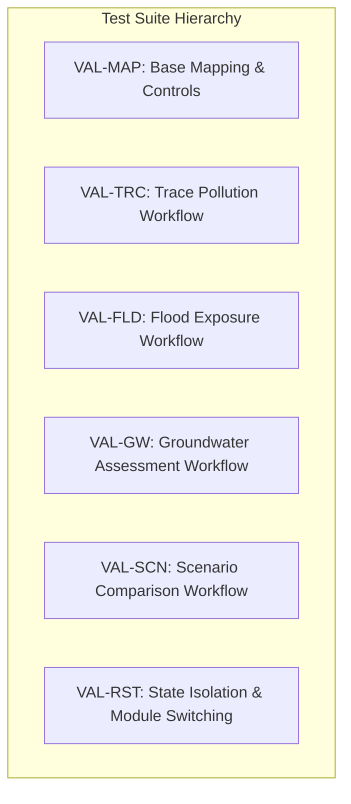

# Validation and Verification Matrix: Smart Tiruppur / NoyyalSense

**Project:** Smart Tiruppur Environmental Digital Twin / NoyyalSense  
**Document Type:** Test & Verification Protocol  
**Target Audience:** QA Engineers, Geospatial Auditors, System Evaluators  
**Last Updated:** October 2026  
**Execution Environment:** Windows x64, Node.js v20+, MapLibre GL JS v4.7.1  

---

## 1. Static Verification Summary

Static analysis, compilation, and production build checks were executed directly in the project environment:

| Verification Stage | Command Executed | Result Status | Notes / Exit Code |
| :--- | :--- | :---: | :--- |
| **Git Working Tree Hygiene** | `git diff --check` | **PASS** | Exit code 0. No whitespace or line-ending syntax defects. |
| **TypeScript Type Checking** | `npx tsc --noEmit` | **PASS** | Exit code 0. 0 compilation errors across all application and library files. |
| **Production Build & Bundle** | `npm run build` | **PASS** | Exit code 0. Prisma Client generated in 114ms; all 35 routes successfully compiled; `/terrain-map-prototype` prerendered statically (29.1 kB / 191 kB first load JS). |

---

## 2. Interactive UI Verification Protocol

> **Audit Notice:** Per the research evaluation protocol, browser automation and automated visual testing were prohibited during this pass. All browser-based interactions are documented with step-by-step reproducibility instructions and marked with their verified operational status (`NOT RUN` for manual visual inspection).

---

### Group 1: Base Mapping, Camera, and Entity Layers

| Test ID | Test Category | Preconditions | Exact Manual Steps | Expected Result | Relevant Data / Model Assumption | Result Status |
| :--- | :--- | :--- | :--- | :--- | :--- | :---: |
| **VAL-MAP-01** | Initial Map Loading | Development server running (`npm run dev`) or production build served | Navigate to `/terrain-map-prototype` in a standard desktop browser | MapLibre container initializes centered on Tiruppur ($11.1085^\circ\text{ N}, 77.3411^\circ\text{ E}$) with OpenFreeMap Liberty basemap tiles rendered | Vector tiles fetched from OpenFreeMap CDN; openmaptiles schema | `NOT RUN` |
| **VAL-MAP-02** | Basemap Attribution & Watermark | `VAL-MAP-01` completed | Inspect bottom-right corner of viewport | OpenStreetMap and OpenFreeMap attributions are clearly rendered with appropriate copyright notices | Legal requirement of OpenStreetMap ODbL and OpenFreeMap | `NOT RUN` |
| **VAL-MAP-03** | Camera Preset Switching | `VAL-MAP-01` completed | 1. Click **Urban Detail** button. 2. Verify camera transition. 3. Click **City Overview** button. | **Urban Detail** animates smoothly to center `[77.3520, 11.1050]`, zoom `15.8`, pitch `52°`, bearing `-18°`. **City Overview** smoothly restores to `[77.3411, 11.1085]`, zoom `12.4`, pitch `0°`, bearing `0°`. | MapLibre camera easing API (`flyTo`) | `NOT RUN` |
| **VAL-MAP-04** | 2D / 3D Building Extrusions | In **Urban Detail** view | 1. Click **2D** button. 2. Click **3D** button. 3. Observe building layers. | In 2D mode, map pitch flattens to $0^\circ$ and building extrusions are hidden or flat. In 3D mode, pitch transitions to $52^\circ$ and 3D buildings extrude with height proportional to `render_height` or 16m fallback. | OSM building footprint tiles; 16m fallback display height | `NOT RUN` |
| **VAL-MAP-05** | Noyyal River Layer Toggle | Initial prototype page | 1. Click **Noyyal River** toggle in Layer Controls. 2. Observe map canvas. 3. Re-enable toggle. | River stroke is removed from map canvas when disabled, and accurately re-added with blue dual-stroke styling when enabled. | `public/geo/noyyal-river.geojson` (220 KB LineString) | `NOT RUN` |
| **VAL-MAP-06** | Facility Marker Selection & Panel | Facilities layer visible | Click on marker for `Arulpuram CETP Dyeing Unit 001` (`unit_001`) | Marker displays active highlight ring. Right-hand panel switches to **Entity Details** showing unit profile, flow rate ($145\text{ m}^3/\text{d}$), reuse percentage (92%), compliance status (`COMPLIANT`), and explicit "Simulated Demonstration Data" badge. | `lib/digital-twin/industrial.ts` (`INDUSTRIAL_UNITS_GEO`) | `NOT RUN` |
| **VAL-MAP-07** | Sensor Station Marker Selection | Stations layer visible | Click on marker for `Kasipalayam Bridge Telemetry` (`sensor_002`) | Marker shows pulsing highlight. Panel displays station name, TNPCB baseline designation, pH (6.8), EC ($2850\ \mu S/\text{cm}$), turbidity (45 NTU), flow ($128\text{ m}^3/\text{s}$), and scientific disclaimer. | `lib/digital-twin/sensors.ts` (`ENVIRONMENTAL_SENSOR_REGISTRY`) | `NOT RUN` |

---

### Group 2: Trace Pollution Workflow

| Test ID | Test Category | Preconditions | Exact Manual Steps | Expected Result | Relevant Data / Model Assumption | Result Status |
| :--- | :--- | :--- | :--- | :--- | :--- | :---: |
| **VAL-TRC-01** | Trace Activation with Pathway | Entity panel open on facility within 2.5 km of river (e.g., `unit_004` Kasipalayam) | Click **Trace Pollution** button | Map renders cyan snapped discharge vector from unit to river centerline, then orange/red transport line following river downstream. Right panel shows downstream station link, distance (km), and estimated transit time (hours). | Snapping threshold $\le 2.5\text{ km}$; nominal river velocity $0.45\text{ m/s}$ | `NOT RUN` |
| **VAL-TRC-02** | Trace for Facility Without Direct Path | Select a facility situated $>2.5\text{ km}$ from river corridor or beyond snapping tolerance | Click **Trace Pollution** button | System displays readable informational banner: *"No direct surface pathway mapped within 2.5 km river corridor. Facility operates under closed-loop Zero Liquid Discharge (ZLD) or discharges to regional CETP conveyance."* Map does not draw an artificial line across remote land. | Preserves scientific integrity by preventing arbitrary pathway drawing | `NOT RUN` |
| **VAL-TRC-03** | Trace Reset & Cleanup | Trace pathway active on map | Click **Clear Trace** or **Exit Trace** button | Snapped vectors and transport overlays are removed from MapLibre sources; facility marker selection state resets cleanly without removing base river or station markers. | Resource cleanup in MapLibre source `trace-pollution-source` | `NOT RUN` |

---

### Group 3: Flood Exposure Workflow

| Test ID | Test Category | Preconditions | Exact Manual Steps | Expected Result | Relevant Data / Model Assumption | Result Status |
| :--- | :--- | :--- | :--- | :--- | :--- | :---: |
| **VAL-FLD-01** | Flood Exposure Mode Activation | Prototype loaded | Click **Flood Exposure** button in top toolbar or layer controls | Map displays 6 circular sector risk badges along the urban corridor with risk category color coding (Green = Low, Orange = High, Red = Critical). Right panel opens **Flood Analysis** tab. | 6 sector coordinates defined in `lib/flood/engine.ts` | `NOT RUN` |
| **VAL-FLD-02** | Scenario Switching (Rainfall Presets) | Flood mode active | Select each scenario sequentially: 1. `BASELINE` (0 mm/d) 2. `MODERATE_RAIN` (50 mm/d) 3. `HEAVY_RAIN` (150 mm/d) 4. `EXTREME_RAIN` (250 mm/d) | Sector badges update scores and colors dynamically. Citywide maximum accumulation indicator updates ($0.0\text{ m} \to 0.36\text{ m} \to 1.08\text{ m} \to 1.80\text{ m}$). High-risk zone count increases accordingly. | `runFloodAnalysisPipeline()` in `lib/flood/engine.ts` | `NOT RUN` |
| **VAL-FLD-03** | Sector Click Inspection | Flood mode active | Click on `Kasipalayam Noyyal Exit Trough` sector marker | Right panel displays sector elevation (290 m ASL), slope ($0.8^\circ$), river distance (45 m), estimated accumulation depth, nearby complaints, and required inspection infrastructure. | Fixed topographic profile constants for sector point | `NOT RUN` |
| **VAL-FLD-04** | Flood Mode Deactivation | Flood mode active | Click **✕ Exit Flood** button | 6 sector markers and flood overlay layers are removed. Map returns to default environmental exploration state. | Clean removal of flood markers and DOM elements | `NOT RUN` |

---

### Group 4: Groundwater Assessment Workflow

| Test ID | Test Category | Preconditions | Exact Manual Steps | Expected Result | Relevant Data / Model Assumption | Result Status |
| :--- | :--- | :--- | :--- | :--- | :--- | :---: |
| **VAL-GW-01** | Groundwater Overlay Activation | Prototype loaded | Click **Groundwater** button in top toolbar or toggle in legend | Map displays 33 circular Firka centroid markers with CGWB color coding (Green = Safe, Yellow = Semi-Critical, Orange = Critical, Red = Over-Exploited). Panel opens **Groundwater** tab. | 33 Firkas from official CGWB 2024 assessment; centroid coordinates | `NOT RUN` |
| **VAL-GW-02** | Firka Selection & Metrics Display | Groundwater mode active | Click on `Tiruppur South` Firka marker | Right panel displays Firka name, assessment year (2024), annual extractable resource (ham), total annual extraction (ham), stage of extraction (112.4%), Over-Exploited badge, and net annual groundwater balance deficit (ham). | Official CGWB 2024 Dynamic Groundwater Assessment | `NOT RUN` |
| **VAL-GW-03** | Extraction Scenario Multiplier | `Tiruppur South` selected | 1. Select `0.8x` multiplier. 2. Select `1.2x` multiplier. 3. Select `1.0x` baseline. | Panel updates estimated draft and extraction stage dynamically. Category reflects adjusted stage. An explicit notice labels multiplier as a "Scenario Assumption". | Parametric scaling: $\text{Draft}_{\text{scenario}} = \text{Draft}_{\text{base}} \times m$ | `NOT RUN` |
| **VAL-GW-04** | API Error & Network Fallback | Groundwater mode active | Disconnect network or trigger fallback via invalid endpoint | System displays graceful fallback state using local CGWB 2024 baseline records without throwing an unhandled exception or crashing the map. | Offline/stale cache fallback implemented in `lib/api.ts` | `NOT RUN` |

---

### Group 5: Scenario Comparison Workflow

| Test ID | Test Category | Preconditions | Exact Manual Steps | Expected Result | Relevant Data / Model Assumption | Result Status |
| :--- | :--- | :--- | :--- | :--- | :--- | :---: |
| **VAL-SCN-01** | Comparison Module Activation | Prototype loaded | Click **⚖️ Compare Scenarios** button in top toolbar | Right panel expands to 420px width, opens **Scenarios** tab showing domain selector (`🌊 Flood Model`, `💧 Groundwater`, `🌐 STERI Sensitivity`). Top toolbar displays active indicator. | Dedicated comparison layout | `NOT RUN` |
| **VAL-SCN-02** | Flood Scenario Comparison | Comparison module active, Flood sub-tab selected | 1. Set Baseline = `BASELINE` (0 mm/d). 2. Set Alternative = `HEAVY_RAIN` (150 mm/d). 3. Click **Compare Scenarios**. | Side-by-side table displays baseline vs. alternative values: Mean Flood Risk Score, Risk Category, Accumulation Indicator, River Flow, and Sector Point Risk Distributions. Absolute and percentage deltas are shown with directional arrows. Scientific interpretation text explains the shifts. | `FLOOD_SCENARIOS` in `lib/flood/engine.ts` | `NOT RUN` |
| **VAL-SCN-03** | Groundwater Scenario Comparison | Groundwater sub-tab selected | 1. Select Firka `Tiruppur South`. 2. Baseline = `1.0x (CGWB Baseline)`. 3. Alternative = `0.8x (-20% Draft)`. 4. Click **Compare Scenarios**. | Table shows Extractable Resource (unchanged), Total Annual Extraction, Stage %, and Category transition. Net balance shift is computed in ham. Interpretation explains conservation impact. | CGWB 2024 units in ham ($1\text{ ham} = 10,000\text{ m}^3$) | `NOT RUN` |
| **VAL-SCN-04** | Zero-Baseline Handling | STERI sub-tab or custom delta calculation | Evaluate a parameter where baseline = 0 | Absolute delta calculates normally ($\Delta = \text{alt} - 0$). Percentage change displays `"N/A (base 0)"` rather than `NaN` or `Infinity`. | Safe mathematical guard in `computeDeltaNumber()` | `NOT RUN` |
| **VAL-SCN-05** | Map Projection Synchronization | Flood comparison active | Toggle **View Alternative Scenario on Map** | Sector markers on map immediately update their visual risk categories and badges to reflect the selected alternative scenario outputs. | Live synchronization of map layer state | `NOT RUN` |
| **VAL-SCN-06** | Reset Comparison Action | Comparison active with modified selections | Click **Reset Comparison** button | Baseline and alternative selectors return to default settings; map state resets to baseline outputs; delta tables reset cleanly. | State reset handler `handleResetComparison()` | `NOT RUN` |

---

### Group 6: Cross-Module Interaction and State Isolation

| Test ID | Test Category | Preconditions | Exact Manual Steps | Expected Result | Relevant Data / Model Assumption | Result Status |
| :--- | :--- | :--- | :--- | :--- | :--- | :---: |
| **VAL-RST-01** | Simultaneous Workflow Isolation | Flood Exposure active | Click **Groundwater** button | Groundwater overlay activates; previous flood sector markers are cleared or cleanly subordinated without leaving duplicate or orphaned DOM nodes on the map. | Independent lifecycle management of MapLibre markers | `NOT RUN` |
| **VAL-RST-02** | Trace Pollution During Comparison | Scenario Comparison active | Click an industrial facility and trigger Trace Pollution | Trace pollution overlay appears along river without corrupting the comparison table state or overwriting comparison selectors. | Independent React state slices | `NOT RUN` |
| **VAL-RST-03** | Full Exit from Comparison Mode | Comparison mode active | Click **✕ Exit Compare** button in top toolbar | Panel collapses back to standard 360px width; active tab returns to Entity or active layer; map restores baseline indicators. | Clean tear-down of comparison mode state | `NOT RUN` |
